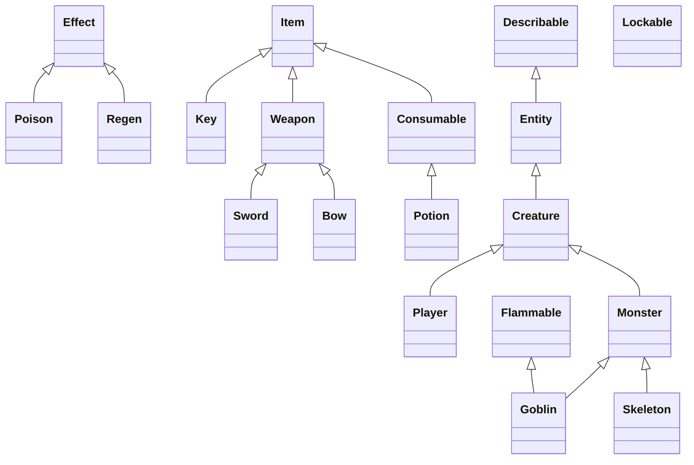

# Challenge 4.3: What's a Class Hierarchy?

## Class Hierarchy Diagram

The following Mermaid diagram illustrates the inheritance
relationships between the Python classes provided in
Challenge 4.3, including multiple inheritance.

