# Bend Bike Shop Functional Specification

## Section 1: Overview

The Bend Bike Shop system is a web-based application that allows customers to browse available bikes, make reservations, and pay for rentals online or through an in-store kiosk. The system also allows employees to manage reservations, process bike pickups and returns, track maintenance, and handle payments, while managers can oversee inventory, manage refunds, and review rental reports.

## Section 2: User Scenarios

### Scenario 1: Customer Renting Bikes

Mike is visiting Bend with his wife for the weekend and wants to rent two bikes to explore the area. He opens the Bend Bike Shop website and is greeted by a welcome page where he has the option to sign in, register a new account, or continue as a guest.

Mike decides to continue as a guest and is directed to the bike rental page. He can browse the different bikes available for rent and select the date and time he would like to rent them. The system displays the bikes available during his selected rental period.

Mike selects two bikes and proceeds to the reservation details page, where he enters his name, phone number, and other required information. The system displays the rental details and total cost.

Before proceeding to checkout, Mike is directed to the shop's existing online waiver system, where he reviews and signs the rental agreement and release of liability.

Once the waiver is completed, Mike proceeds to the checkout screen, where he enters his payment information. The system processes the payment through its payment processor and confirms the reservation.

Mike receives a confirmation containing his rental details and pickup information. When he arrives at Bend Bike Shop during business hours, an employee verifies his reservation and provides the bikes.

### Scenario 2: Employee Processing a Late Return

Sarah is an employee at Bend Bike Shop and is responsible for managing bike returns throughout her shift. She logs into the employee dashboard to monitor active reservations and upcoming returns.

The system automatically tracks rental times and flags reservations that have passed their scheduled return time. When a customer returns a bike two hours late, Sarah locates the customer's reservation and verifies the bike being returned.

Sarah physically inspects the bike for damage and checks that any rented equipment, such as a helmet, has also been returned. She records the condition of the bike in the system.

After Sarah completes the inspection, she updates the reservation to indicate that the bike has been returned. The system calculates any applicable late fees and displays the outstanding balance.

Sarah reviews the charges and processes any additional payment through the shop's payment system. If the customer has an issue with the charges or requests an exception, Sarah can refer the situation to a manager for review.

Once the return is completed, the system updates the reservation status. If the bike is in good condition, it becomes available for future rentals. If the bike requires maintenance, Sarah marks it as unavailable so customers cannot reserve it.

### Scenario 3: Customer Canceling a Reservation (AI-Generated)

Jessica is planning a weekend trip to Bend with a group of friends. Two weeks before their trip, she reserves four mountain bikes through the Bend Bike Shop website and completes the payment.

A few days before the trip, Jessica learns that two of her friends can no longer attend. She opens the Bend Bike Shop website and accesses her reservation using her confirmation information.

Jessica selects the option to modify or cancel her reservation. The system displays her reservation details and the cancellation fees that apply to each bicycle.

Since Jessica only needs two bikes, she chooses to cancel two of the four reserved bikes. The system calculates the cancellation fees based on how close the reservation date is and displays the amount she will receive back.

Jessica reviews the changes and confirms her request. The system updates her reservation, releases the two canceled bikes back into the available inventory, and displays the updated reservation details.

If the cancellation requires a refund, the system sends the request to a manager for authorization. Once the manager approves the refund, it is processed through the payment system.

Jessica receives an updated confirmation showing her two remaining bike reservations and any applicable cancellation charges.

### Scenario 4: Manager Managing Bike Maintenance (AI-Generated)

David is a manager at Bend Bike Shop and is responsible for making sure the rental inventory is ready for customers. During a busy summer morning, an employee informs him that one of the mountain bikes has a problem with its brakes and should not be rented.

David logs into the management dashboard and opens the bike inventory page. He searches for the bicycle using its store identification number and opens its details.

David selects the option to mark the bike as unavailable and records that it requires brake maintenance. The system updates the bicycle's status and removes it from the available rental inventory.

The system also checks whether the bike has any upcoming reservations that may be affected by its maintenance status. David reviews any affected reservations and determines whether another available bicycle can be assigned.

After the bike has been repaired and inspected, David returns to the inventory page and updates its status to available.

The system adds the bicycle back into the available rental inventory, allowing customers to reserve it again for dates and times when it is not already booked.

David can now return to the management dashboard and continue monitoring bike availability and rental activity.

## Section 3: Non-Goals

The following features will not be included in the Bend Bike Shop system based on the requirements gathered from Rodney Ridealot.

- **Self-Service Bike Pickups and Returns:** Customers will not be able to pick up or return bikes without an employee present. All bike exchanges must take place during normal business hours.

- **Automatic Replacement Charges for Lost Bikes:** The system will not automatically charge customers the full replacement cost of a lost or stolen bicycle. A manager must review the situation and determine the appropriate action.

- **Advertising on Rental Kiosks:** The system will not display advertisements on the rental kiosks because Rodney believes they would distract customers.

- **Automated Marketing Campaigns:** The system will not manage advertising campaigns or promotional outreach through platforms such as Google Ads. Bend Bike Shop already has a separate team responsible for marketing.

- **Creating a New Liability Waiver System:** The system will not create or manage its own liability waiver service. Instead, it will integrate with the online waiver system already used by Bend Bike Shop.

- **Automated Bike Recommendations:** The system will not automatically recommend bicycles based on customer preferences. Customers can browse available bicycles, and employees can help them choose an appropriate bike when needed.

## Section 4: Use Case Diagrams

The following UML use case diagram shows how customers, employees, and managers interact with the Bend Bike Shop Rental System.

Customers can browse available bikes, make reservations, complete payments, and cancel reservations.

Employees can process bike pickups and returns, while managers can manage bike inventory and authorize refunds.

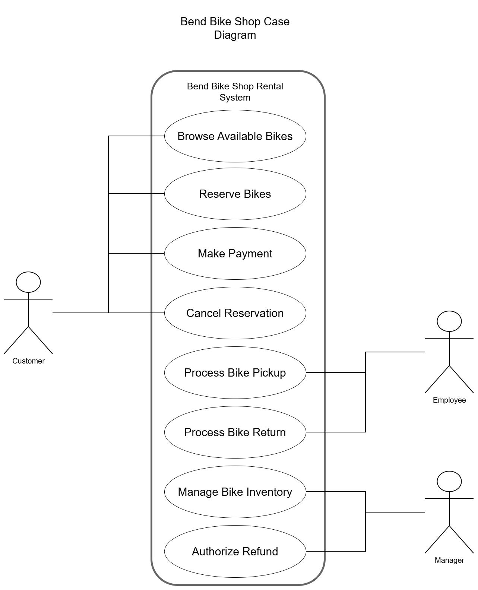

## Section 5: UX Flow Diagrams

The following diagrams show how users move between screens to complete three scenarios from Section 2. The diagrams focus on user-facing screens rather than system architecture.

### 5.1 Customer Renting Bikes — Mike

Mike continues as a guest, chooses his rental dates and times, selects two bicycles, enters his contact information, completes the shop's existing external waiver, and pays for his reservation.

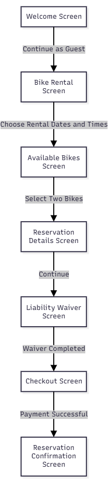

### 5.2 Employee Processing a Late Return — Sarah

Sarah locates an overdue rental, records the bicycle inspection, reviews any additional charges, and completes the return. If charges are disputed, she refers the issue to a manager; the bicycle is made available again only if it does not require maintenance.

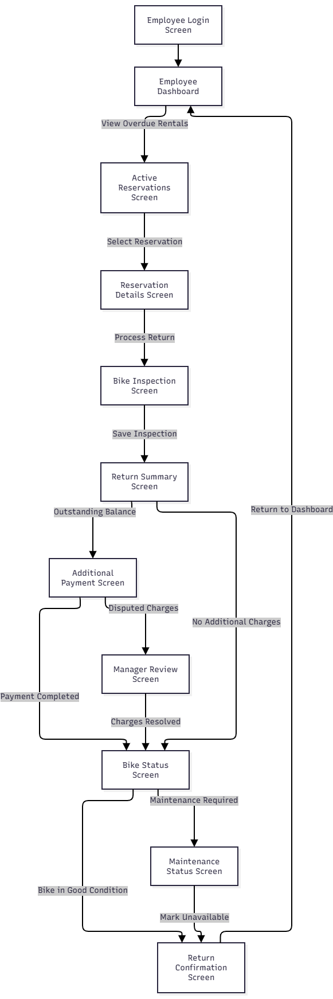

### 5.3 Manager Managing Bike Maintenance — David

David locates the affected bicycle, records the maintenance issue, and removes the bicycle from available inventory. He reviews affected reservations and possible replacements, then returns the bicycle to available status after it has been repaired and inspected.

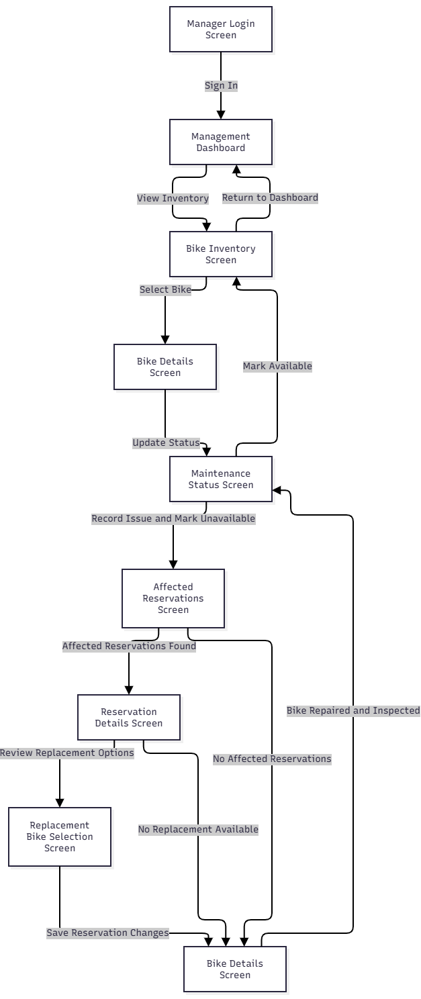

## Section 6: Wireframes

The following low-fidelity wireframes represent **Scenario 1: Customer Renting Bikes (Mike)**. Each sketch shows the main content and controls on a screen and the navigation needed to complete the reservation. The bicycle types and prices shown are illustrative placeholders, not finalized inventory or pricing.

### 6.1 Welcome Screen

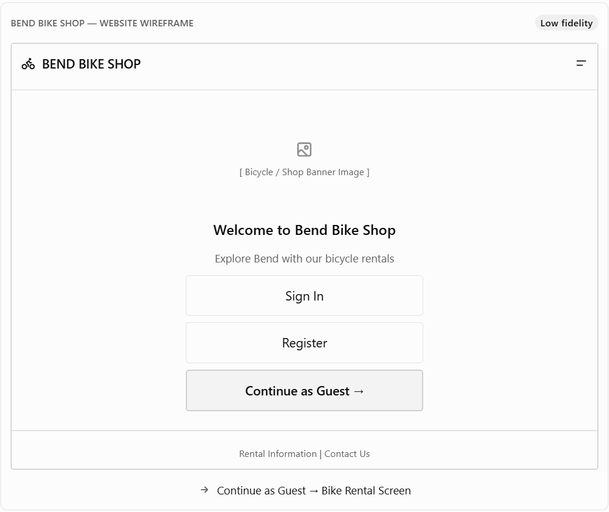

The Welcome Screen introduces customers to Bend Bike Shop and provides options to sign in, register an account, or continue as a guest. Mike selects **Continue as Guest** to access the Bike Rental Screen without creating an account.

**Navigation:** Continue as Guest → Bike Rental Screen.

### 6.2 Bike Rental Screen

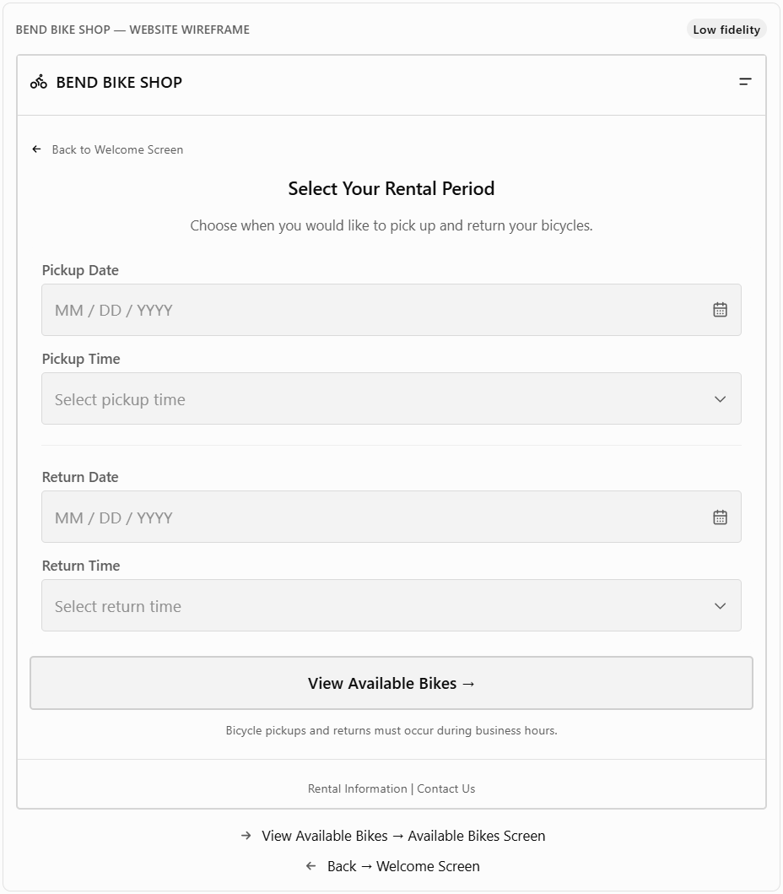

The Bike Rental Screen allows customers to select their preferred pickup and return dates and times. Mike enters his desired rental period and selects **View Available Bikes** to see which bicycles are available during that time. He can also return to the Welcome Screen if needed.

**Navigation:** View Available Bikes → Available Bikes Screen; Back → Welcome Screen.

### 6.3 Available Bikes Screen

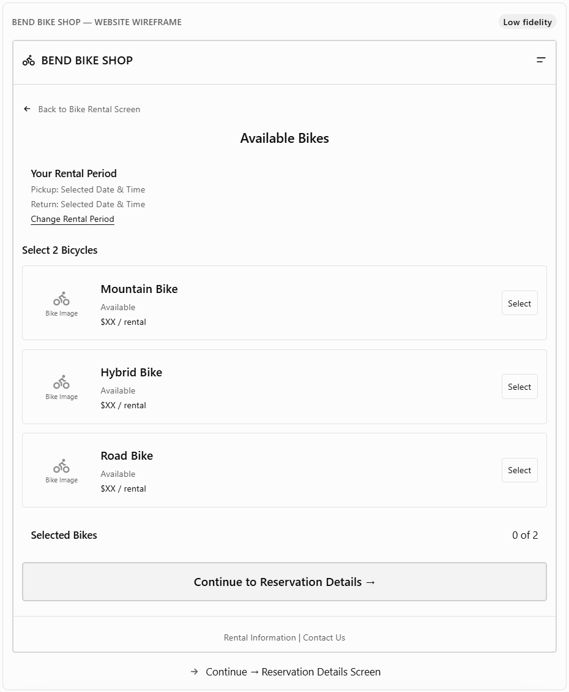

The Available Bikes Screen displays bicycles available during the selected rental period, including bicycle types and rental prices. Mike browses the options, selects two bicycles, and continues to the Reservation Details Screen. He can also return to the Bike Rental Screen to change his dates and times.

**Navigation:** Continue to Reservation Details → Reservation Details Screen; Back / Change Rental Period → Bike Rental Screen.

### 6.4 Reservation Details Screen

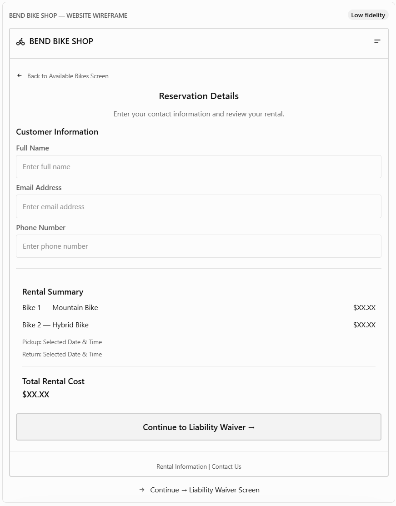

The Reservation Details Screen collects the customer's name, email address, phone number, and other required reservation information. Mike reviews his selected bicycles, rental dates, and total cost before continuing to the Liability Waiver Screen. He can return to the Available Bikes Screen to change his selections.

**Navigation:** Continue to Liability Waiver → Liability Waiver Screen; Back → Available Bikes Screen.

### 6.5 Liability Waiver Screen

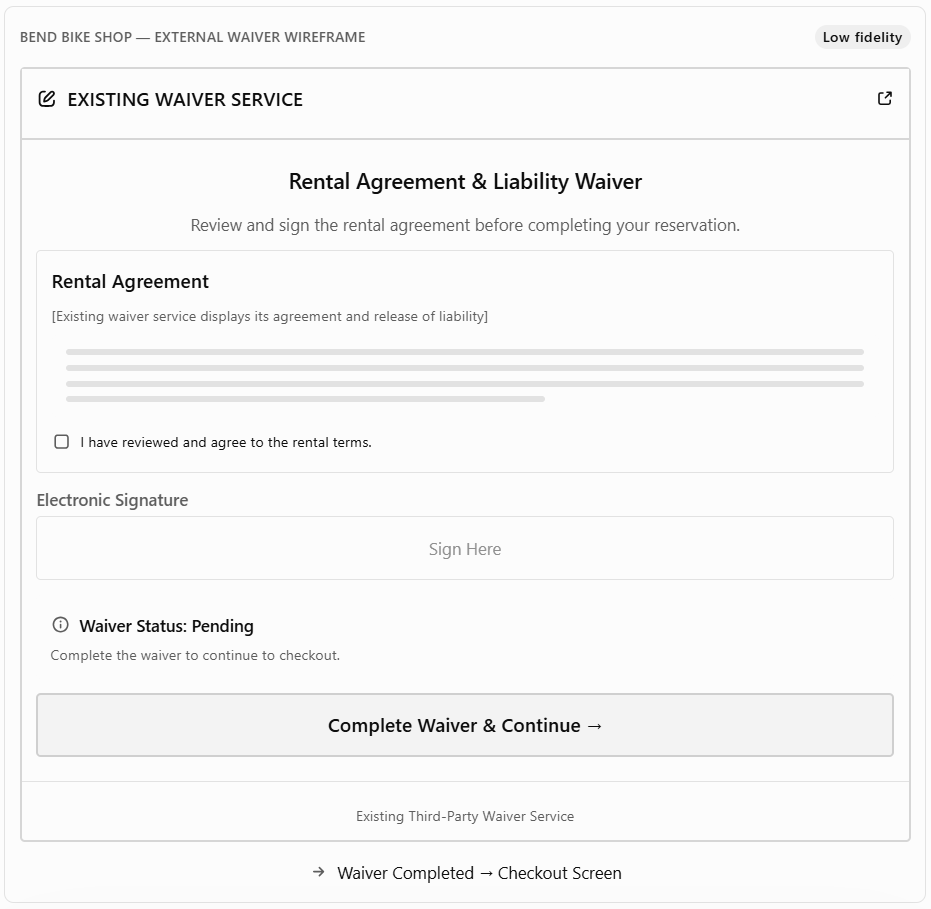

The Liability Waiver Screen represents Bend Bike Shop's **existing third-party waiver service**, where customers review and electronically sign the rental agreement and release of liability. Mike completes the required waiver before returning to the reservation process and proceeding to checkout. This sketch is conceptual because the exact interface of the existing service has not been specified.

**Navigation:** Complete Waiver & Continue → Checkout Screen.

### 6.6 Checkout Screen

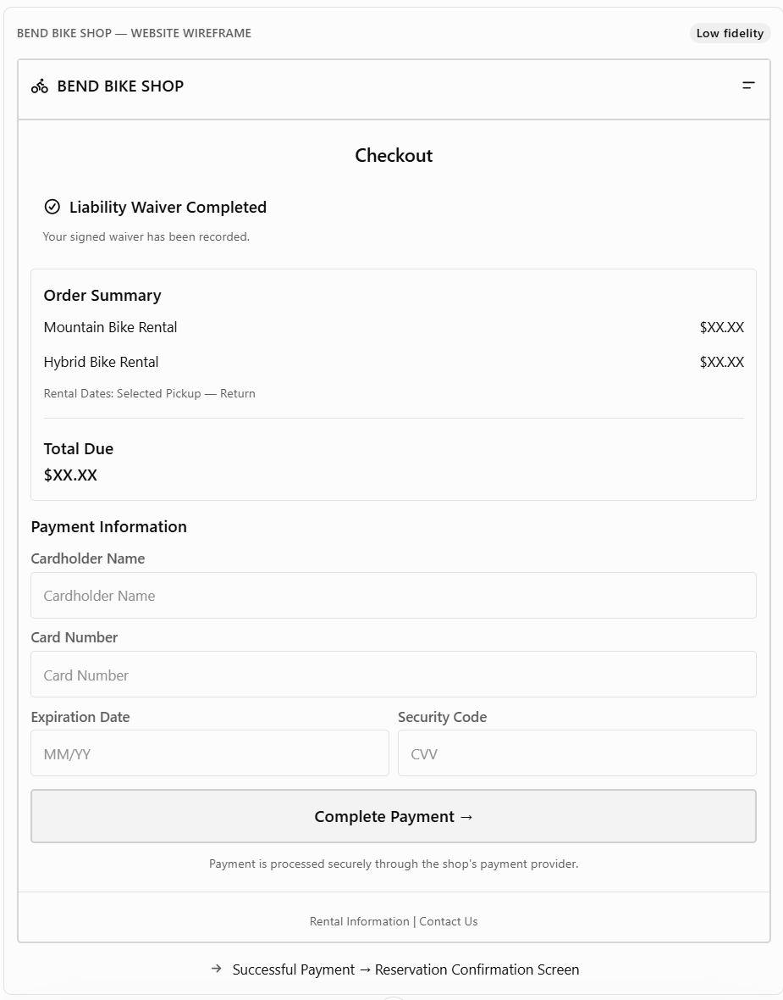

The Checkout Screen displays the selected bicycle rentals, rental dates, total payment amount, and completed waiver status. Mike enters his payment information and selects **Complete Payment** to submit the transaction through the shop's payment processor. After successful payment, the system directs him to the Reservation Confirmation Screen.

**Navigation:** Complete Payment (successful) → Reservation Confirmation Screen.

### 6.7 Reservation Confirmation Screen

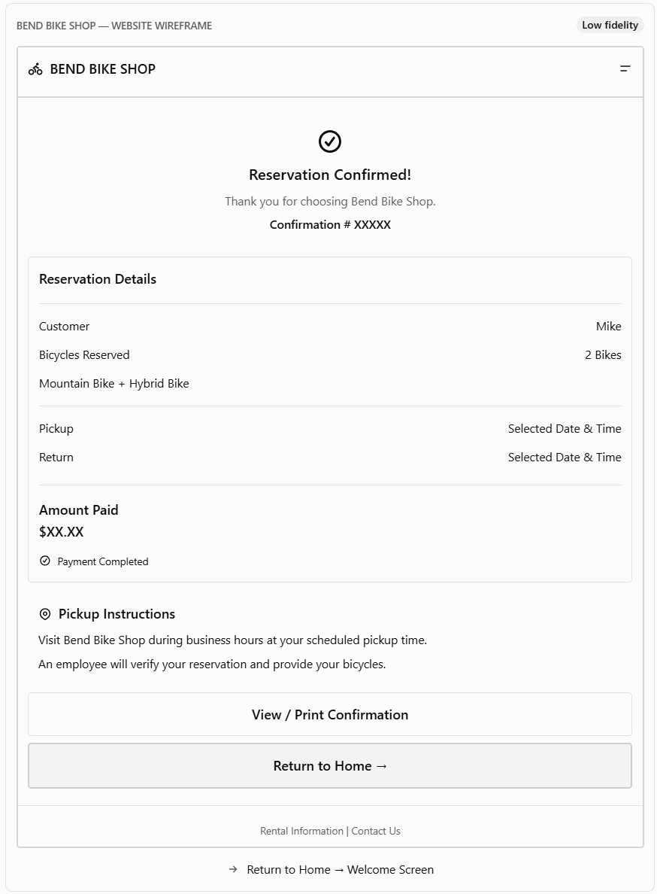

The Reservation Confirmation Screen displays the reservation number, selected bicycles, rental dates, payment confirmation, and pickup instructions. Mike can review or print his confirmation and present his reservation information when an employee provides the bicycles during business hours. He can also return to the Welcome Screen.

**Navigation:** Return to Home → Welcome Screen.
