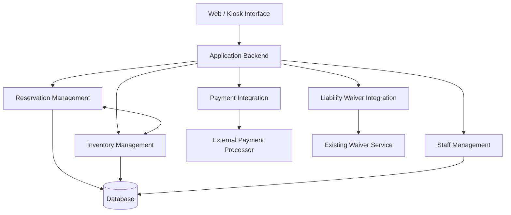

# Bend Bike Shop Technical Design Document

## 1. Overview

The Bend Bike Shop system is a web-based application that allows customers to browse available bicycles, make reservations, and pay for rentals online or through an in-store kiosk. Employees can manage reservations, process bicycle pickups and returns, record inspections, and handle additional charges. Managers can oversee bicycle inventory, manage maintenance, authorize refunds, and review rental activity.

The system will integrate with the shop's existing liability waiver service and an external payment processor. This document describes the technical design of the system, including its major components, their responsibilities, and how they interact.

## 2. Actors

The Bend Bike Shop system interacts with the following actors:

- **Customer:** Browses available bicycles, creates reservations, completes liability waivers, makes payments, and modifies or cancels existing reservations. Customers can use the system through the website or an in-store kiosk without creating an account.
- **Employee:** Manages bicycle pickups and returns, monitors active reservations, records bicycle inspections, processes additional charges, and reports maintenance issues.
- **Manager:** Oversees bicycle inventory and maintenance, reviews affected reservations, authorizes refunds, resolves customer disputes, and reviews rental activity.
- **Payment Processing System:** An external service that processes rental payments, additional charges, and authorized refunds.
- **External Liability Waiver Service:** The shop's existing third-party service that allows customers to review and electronically sign rental agreements and liability waivers.

## 3. Goals/Non-Goals

### Goals

The primary goal of the Bend Bike Shop system is to simplify bicycle rentals for customers while providing employees and managers with the tools needed to manage daily rental operations.

The system will:

- Allow customers to browse available bicycles, make reservations, and complete payments online or through an in-store kiosk.
- Support guest reservations without requiring customers to create an account.
- Integrate with the shop's existing liability waiver service and an external payment processor.
- Allow customers to modify or cancel reservations, including partial cancellations.
- Allow employees to manage pickups, returns, inspections, late fees, and additional charges.
- Allow managers to manage bicycle inventory, maintenance, refunds, disputes, and rental activity.
- Keep bicycle availability updated to prevent conflicting reservations and exclude bicycles requiring maintenance.

### Non-Goals

The following features are outside the scope of the Bend Bike Shop system:

- **Self-Service Pickups and Returns:** Customers must pick up and return bicycles with an employee present during normal business hours.
- **Automatic Replacement Charges:** The system will not automatically charge customers the replacement cost of lost or stolen bicycles. A manager must review these situations.
- **Kiosk Advertising:** The system will not display advertisements on rental kiosks.
- **Automated Marketing Campaigns:** The system will not manage advertising campaigns or promotional outreach.
- **New Liability Waiver System:** The system will use the shop's existing third-party waiver service rather than creating its own.
- **Automated Bicycle Recommendations:** The system will not automatically recommend bicycles based on customer preferences.

## 4. Constraints

The Bend Bike Shop system must operate within the following constraints:

1. **Existing Liability Waiver Service:** The system must integrate with Bend Bike Shop's existing third-party liability waiver service rather than developing a new one. Customers must complete the required waiver before proceeding to payment.
2. **Employee-Assisted Pickups and Returns:** All bicycle pickups and returns must be handled by an employee during normal business hours. The system will not support unattended or self-service bicycle exchanges.
3. **External Payment Processing:** Rental payments, additional charges, and refunds must be processed through an external payment processing service rather than handled directly by the application.
4. **Manager Authorization for Refunds:** Refunds must be reviewed and authorized by a manager before they are processed through the payment system.
5. **Bicycle Maintenance Restrictions:** Bicycles marked as requiring maintenance must be excluded from available rental inventory until they have been repaired, inspected, and returned to available status.

## 5. Assumptions

The following assumptions will guide the technical design of the Bend Bike Shop system until they are confirmed with Rodney Ridealot.

1. **Internet Connectivity:** Bend Bike Shop will have a reliable internet connection to support employee dashboards, in-store kiosks, and communication with external services.
2. **Existing Waiver Service Integration:** The shop's current liability waiver service provides a way for the application to verify whether a customer has completed the required waiver.
3. **Payment Processor Capabilities:** The external payment processor supports online payments, additional rental charges, and refunds through an integration that the application can use.
4. **Bicycle Inventory Information:** Bend Bike Shop will provide accurate bicycle inventory information, including unique identification numbers, bicycle types, rental prices, and maintenance status.
5. **Employee and Manager Accounts:** Each employee and manager will have an individual account with appropriate permissions based on their responsibilities.

## 6. Non-Functional Requirements

The Bend Bike Shop system must meet the following measurable requirements:

1. **Response Time:** The system must display bicycle availability search results within 2 seconds for at least 95% of requests under normal operating conditions.
2. **System Availability:** The application must maintain at least 99.5% uptime per calendar month, excluding scheduled maintenance.
3. **Concurrent Users:** The system must support at least 100 simultaneous users browsing bicycles, managing reservations, or accessing employee and manager dashboards without exceeding the defined response-time requirement.
4. **Session Security:** Employee and manager accounts must automatically expire after 15 minutes of inactivity, requiring users to authenticate again before accessing protected functions.
5. **Data Backup and Recovery:** The system must automatically back up reservation and inventory data at least once every 24 hours and support restoration of the latest successful backup within 4 hours.

## 7. Component Diagram and Description

The following diagram shows the major components of the Bend Bike Shop system and their relationships.

| Component | Description |
|---|---|
| Web / Kiosk Interface | Allows customers, employees, and managers to interact with the system. |
| Application Backend | Handles requests from the interface and coordinates system functionality. |
| Reservation Management | Creates, modifies, cancels, and tracks bicycle reservations, including pickups, returns, and late fees. |
| Inventory Management | Tracks bicycles, availability, maintenance status, and rental pricing. |
| Payment Integration | Communicates with the external payment processor to handle payments, additional charges, and refunds. |
| Liability Waiver Integration | Connects to the existing waiver service to verify completed waivers. |
| Staff Management | Handles employee and manager authentication, permissions, and access to administrative functions. |
| Database | Stores reservation, bicycle inventory, customer, and operational information. |
| External Payment Processor | Processes rental payments, additional charges, and authorized refunds. |
| Existing Waiver Service | Allows customers to electronically sign rental agreements and liability waivers. |