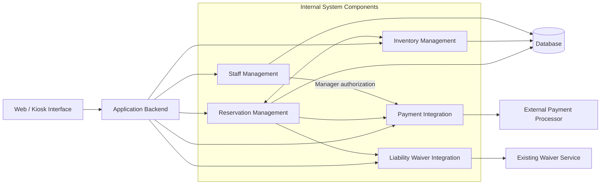

# Bend Bike Shop Technical Design Document

## 1. Overview

The Bend Bike Shop system is a web-based application that allows customers to browse available bicycles, make reservations, and pay for rentals online or through an in-store kiosk. Employees can manage reservations, process bicycle pickups and returns, record inspections, and handle additional charges. Managers can oversee bicycle inventory, manage maintenance, authorize refunds, and review rental activity.

The system will integrate with the shop's existing liability waiver service and an external payment processor. This document describes the technical design of the system, including its major components, their responsibilities, and how they interact.

## 2. Actors

The Bend Bike Shop system interacts with the following actors:

- **Customer:** Browses available bicycles, creates reservations, completes liability waivers, makes payments, and modifies or cancels existing reservations. Customers can use the system through the website or an in-store kiosk without creating an account.
- **Employee:** Manages bicycle pickups and returns, monitors active reservations, records bicycle inspections, processes additional charges, and reports maintenance issues.
- **Manager:** Oversees bicycle inventory and maintenance, reviews affected reservations, authorizes refunds, resolves customer disputes, and reviews rental activity.
- **Payment Processing System:** An external service that processes rental payments, additional charges, and authorized refunds.
- **External Liability Waiver Service:** The shop's existing third-party service that allows customers to review and electronically sign rental agreements and liability waivers.

## 3. Goals/Non-Goals

### 3.1 Goals

The primary goal of the Bend Bike Shop system is to simplify bicycle rentals for customers while providing employees and managers with the tools needed to manage daily rental operations.

The system will:

- Allow customers to browse available bicycles, make reservations, and complete payments online or through an in-store kiosk.
- Support guest reservations without requiring customers to create an account.
- Integrate with the shop's existing liability waiver service and an external payment processor.
- Allow customers to modify or cancel reservations, including partial cancellations.
- Allow employees to manage pickups, returns, inspections, late fees, and additional charges.
- Allow managers to manage bicycle inventory, maintenance, refunds, disputes, and rental activity.
- Keep bicycle availability updated to prevent conflicting reservations and exclude bicycles requiring maintenance.

### 3.2 Non-Goals

The following features are outside the scope of the Bend Bike Shop system:

- **Self-Service Pickups and Returns:** Customers must pick up and return bicycles with an employee present during normal business hours.
- **Automatic Replacement Charges:** The system will not automatically charge customers the replacement cost of lost or stolen bicycles. A manager must review these situations.
- **Kiosk Advertising:** The system will not display advertisements on rental kiosks.
- **Automated Marketing Campaigns:** The system will not manage advertising campaigns or promotional outreach.
- **New Liability Waiver System:** The system will use the shop's existing third-party waiver service rather than creating its own.
- **Automated Bicycle Recommendations:** The system will not automatically recommend bicycles based on customer preferences.

## 4. Constraints

The Bend Bike Shop system must operate within the following constraints:

1. **Existing Liability Waiver Service:** The system must integrate with Bend Bike Shop's existing third-party liability waiver service rather than developing a new one. Customers must complete the required waiver before proceeding to payment.
2. **Employee-Assisted Pickups and Returns:** All bicycle pickups and returns must be handled by an employee during normal business hours. The system will not support unattended or self-service bicycle exchanges.
3. **External Payment Processing:** Rental payments, additional charges, and refunds must be processed through an external payment processing service rather than handled directly by the application.
4. **Manager Authorization for Refunds:** Refunds must be reviewed and authorized by a manager before they are processed through the payment system.
5. **Bicycle Maintenance Restrictions:** Bicycles marked as requiring maintenance must be excluded from available rental inventory until they have been repaired, inspected, and returned to available status.

## 5. Assumptions

The following assumptions will guide the technical design of the Bend Bike Shop system until they are confirmed with Rodney Ridealot.

1. **Internet Connectivity:** Bend Bike Shop will have a reliable internet connection to support employee dashboards, in-store kiosks, and communication with external services.
2. **Existing Waiver Service Integration:** The shop's current liability waiver service provides a way for the application to verify whether a customer has completed the required waiver.
3. **Payment Processor Capabilities:** The external payment processor supports online payments, additional rental charges, and refunds through an integration that the application can use.
4. **Bicycle Inventory Information:** Bend Bike Shop will provide accurate bicycle inventory information, including unique identification numbers, bicycle types, rental prices, and maintenance status.
5. **Employee and Manager Accounts:** Each employee and manager will have an individual account with appropriate permissions based on their responsibilities.

## 6. Non-Functional Requirements

The Bend Bike Shop system must meet the following measurable requirements:

1. **Response Time:** The system must display bicycle availability search results within 2 seconds for at least 95% of requests while supporting up to 100 concurrent users.
2. **System Availability:** The application must maintain at least 99.5% uptime per calendar month, excluding scheduled maintenance.
3. **Concurrent Users:** The system must support at least 100 simultaneous users browsing bicycles, managing reservations, or accessing employee and manager dashboards without exceeding the defined response-time requirement.
4. **Session Security:** Employee and manager accounts must automatically expire after 15 minutes of inactivity, requiring users to authenticate again before accessing protected functions.
5. **Data Backup and Recovery:** The system must automatically back up reservation and inventory data at least once every 24 hours and support restoration of the latest successful backup within 4 hours.

## 7. Component Diagram and Description

The following diagram shows the major components of the Bend Bike Shop system and their relationships. Reservation Management coordinates waiver verification before payment and confirms a reservation after successful payment. Refund requests require verified manager authorization before Payment Integration submits them to the external processor. Payment transaction references and waiver completion statuses are stored with the associated reservation records; sensitive card details remain with the external payment processor.

| Component | Description |
|---|---|
| Web / Kiosk Interface | Allows customers, employees, and managers to interact with the system. |
| Application Backend | Handles requests from the interface and coordinates system functionality. |
| Reservation Management | Creates, modifies, cancels, and tracks bicycle reservations, including pickups, returns, and late fees. Coordinates waiver verification before payment, records payment and waiver statuses and transaction references, and identifies reservations affected by maintenance. Requires authorization verification before guests can access or change existing reservations. Tracks refund requests for manager approval. |
| Inventory Management | Tracks bicycles, availability, maintenance status, and rental pricing. Communicates maintenance-related unavailability to Reservation Management so managers can review affected bookings. |
| Payment Integration | Communicates with the external payment processor to handle payments, additional charges, and refunds. Processes refunds only after manager authorization has been verified. |
| Liability Waiver Integration | Connects to the existing waiver service to verify completed waivers before payment. |
| Staff Management | Handles employee and manager authentication, permissions, and access to administrative functions, including verification of manager permissions for refund approvals. |
| Database | Stores reservation, bicycle inventory, customer, and operational information, including payment transaction references and waiver completion statuses linked to reservations; it does not store customers’ payment card details. |
| External Payment Processor | Processes rental payments, additional charges, and authorized refunds. |
| Existing Waiver Service | Allows customers to electronically sign rental agreements and liability waivers. |

## 8. Detailed Component Responsibilities

The responsibilities below elaborate on Section 7 without changing its component boundaries. Specific implementation mechanisms are **proposed design choices**, not additional customer requirements.

### 8.1 Web / Kiosk Interface

- Present the existing customer flow: welcome, rental dates, available bicycles, reservation details, external waiver, checkout, and confirmation.
- Support guest reservations and access to existing reservations using confirmation information and an additional verification step.
- Provide authenticated employee views for pickups, overdue rentals, inspections, returns, and additional charges.
- Provide authenticated manager views for inventory, maintenance, affected reservations, refund approvals, disputes, and rental activity.
- Display server-provided prices, statuses, and validation errors; do not treat browser calculations as authoritative.
- The kiosk uses the same application workflows and must clear guest reservation details when a session ends.

### 8.2 Application Backend

- Accept interface requests, validate inputs, enforce permissions, and route operations to the appropriate components.
- Coordinate operations spanning reservations, inventory, waivers, and payments.
- Return consistent success/error responses without exposing internal details or sensitive information.
- Use server-side timestamps and authoritative pricing and availability checks.

### 8.3 Reservation Management

- Create and track pending reservations, verify availability, and confirm reservations only after waiver completion and successful payment.
- Track individual bicycles within multi-bike reservations so partial cancellations are possible.
- Calculate applicable rental totals, cancellation fees, and late fees using shop-configured policies. **The actual fee amounts and timing rules are not specified in the Functional Specification and must be confirmed.**
- Handle reservation modifications and cancellations, release canceled bicycle allocations, and request manager review when refunds are due.
- Record employee-assisted pickups and returns, including inspections, outstanding charges, and final reservation status.
- Flag overdue rentals and identify reservations affected by maintenance.

### 8.4 Inventory Management

- Maintain unique store bicycle IDs, bicycle types, rental prices, and operational statuses.
- Calculate availability for a requested rental interval by excluding overlapping reservations and bicycles marked for maintenance.
- Prevent concurrent requests from allocating the same bicycle for overlapping periods.
- Record maintenance issues and ensure repaired bicycles return to availability only after inspection and a manager's status update.
- Identify future reservations impacted by a bicycle becoming unavailable; managers decide whether another available bicycle can be assigned.

### 8.5 Liability Waiver Integration

- Direct customers to the shop's existing waiver service.
- Associate the service's completion reference/status with the corresponding reservation.
- Verify completion through a trusted integration before allowing payment.
- Do not implement an internal waiver signing service. The provider's verification interface and exact integration behavior remain unconfirmed assumptions.

### 8.6 Payment Integration

- Send rental charges, additional charges, and authorized refunds to the external processor.
- Store processor transaction identifiers, amounts, and outcomes without storing full payment-card details.
- Prevent duplicate payment submissions when requests are retried.
- Require verified manager approval before issuing any refund.
- Do not automatically charge the replacement cost of lost or stolen bicycles.

### 8.7 Staff Management

- Authenticate individual employees and managers and enforce role-based permissions.
- Permit employees to process pickups, returns, inspections, and additional charges, and refer disputes to managers.
- Permit managers to manage maintenance and inventory, resolve disputes, and approve refunds.
- Expire staff sessions after 15 minutes of inactivity, as specified in Section 6.

## 9. System Interactions and Workflows

### 9.1 New Customer Reservation

1. A customer selects a pickup and return period on the website or kiosk.
2. Reservation Management requests eligible bicycles from Inventory Management.
3. The customer selects one or more bicycles, enters contact details, and reviews the server-calculated total.
4. Reservation Management creates a pending reservation and checks availability again before committing any allocation.
5. Liability Waiver Integration directs the customer to the existing provider and verifies completion.
6. After waiver verification, Payment Integration requests payment from the external processor.
7. Following confirmed payment, Reservation Management marks the reservation confirmed and retains the bicycle allocations.
8. The interface displays confirmation details and pickup instructions. A confirmation must not be shown as paid until the processor confirms success.

**Proposed implementation safeguard:** Pending allocations should have an expiration policy to avoid holding bicycles indefinitely. The hold duration must be agreed with the shop. If payment succeeds but the final confirmation step fails, the backend should reconcile the processor transaction before allowing another charge.

### 9.2 Employee-Assisted Pickup and Return

1. An employee authenticates and retrieves the customer's reservation.
2. At pickup during business hours, the employee verifies the reservation and hands over the bicycle(s), recording the pickup.
3. The system flags reservations whose scheduled return time has passed.
4. At return, the employee verifies each bicycle, inspects its condition and rented equipment, and records findings.
5. Reservation Management calculates any applicable late fees; the employee reviews and processes additional payment through Payment Integration.
6. Disputed charges are referred to a manager for review.
7. The reservation's returned items are recorded. Inventory Management makes a bicycle available for future rentals only when it is not blocked for maintenance or another reservation.

### 9.3 Partial Cancellation and Refund

1. A customer accesses an existing reservation using confirmation information and an additional verification mechanism.
2. Reservation Management shows the reservation's individual bicycles and applicable cancellation fees.
3. The customer selects the bicycles to cancel and reviews the revised total and potential refund.
4. The system records the cancellation, releases only the canceled bicycle allocations, and updates the remaining reservation.
5. When a refund is due, a refund request remains pending until a manager approves it.
6. After approval, Payment Integration submits the refund to the external processor and records its result.
7. The customer receives updated reservation details and the known refund status.

**Important:** The specification establishes cancellation fees but not their numerical schedule or whether changes have cutoff times. These are configurable business rules requiring confirmation.

### 9.4 Maintenance and Affected Reservations

1. An employee reports a bicycle problem, or a manager identifies it.
2. The manager finds the bicycle by store ID and marks it unavailable for maintenance, recording the issue.
3. Inventory Management excludes the bicycle from new availability results immediately.
4. Reservation Management identifies upcoming reservations using the bicycle.
5. The manager reviews affected reservations and may assign another eligible, unreserved bicycle.
6. After repair and inspection, the manager marks the original bicycle available again.

## 10. Data Management and Storage

A relational database is a **proposed implementation choice** because reservations, individual bicycles, payment references, and maintenance records have clear relationships. The existing document specifies a database but does not mandate a database product.

| Logical entity | Representative fields | Purpose |
|---|---|---|
| Bicycle | bicycle_id, type, rental_price, operational_status | Inventory identity, pricing, and maintenance eligibility |
| Reservation | reservation_id, customer_id/contact_reference, pickup_at, return_at, status, quoted_total | Overall booking and lifecycle |
| ReservationItem | reservation_item_id, reservation_id, bicycle_id, item_status, rental_price | Each bicycle in a booking; enables partial cancellations |
| CustomerContact | customer_id, name, email, phone | Required contact and confirmation details, including guest reservations |
| WaiverVerification | reservation_id, provider_reference, verification_status, verified_at | Evidence of completion from the external waiver service |
| PaymentTransaction | transaction_id, reservation_id, processor_reference, type, amount, status | Payment, additional charge, and refund history without card details |
| RefundRequest | refund_request_id, reservation_id, amount, reason, approval_status, manager_id | Manager approval before refund processing |
| StaffAccount | staff_id, role, authentication_reference, account_status | Individual employee/manager access |
| Inspection | inspection_id, reservation_item_id, staff_id, condition_notes, inspected_at | Return condition and equipment observations |
| MaintenanceRecord | maintenance_id, bicycle_id, issue, status, inspection_notes, updated_by | Maintenance and return-to-service tracking |

These are **logical entities**, not a finalized schema. Field types, indexes, retention periods, and database technology require implementation decisions.

### 10.1 Data Integrity

- Use unique IDs and foreign-key relationships to connect reservation items, bicycles, transactions, and maintenance records.
- Reject invalid rental periods, missing required customer information, and nonexistent bicycle IDs.
- Enforce no overlapping active allocations for the same bicycle through an atomic reservation operation (for example, transaction-controlled locking or equivalent concurrency protection).
- Apply status transitions consistently: a canceled reservation item cannot be picked up; a maintenance-blocked bicycle cannot be newly allocated.
- Record timestamps for significant reservation, payment, refund, inspection, and maintenance changes.
- Keep transaction history even when reservation items are canceled, so refund decisions remain traceable.

### 10.2 Backup and Recovery

- Back up reservation and inventory data at least once every 24 hours.
- Design restoration procedures to restore the latest successful backup within four hours.
- Restrict backup access and protect backup data in transit and at rest.
- After recovery, reconcile payment and waiver references with external providers before retrying uncertain operations.

## 11. Security and Access Control

| Action | Customer / guest | Employee | Manager |
|---|---|---|---|
| Browse bicycles and make a reservation | Yes | As needed | As needed |
| Access or modify own reservation | With reservation verification | For operational duties | For operational duties |
| Process pickup, inspection, and return | No | Yes | Yes |
| Record additional rental charges | No | Yes | Yes |
| Update maintenance and inventory status | No | Report issues | Yes |
| Approve refunds | No | No | Yes |
| Review and resolve disputes | Submit/refer issue | Refer to manager | Yes |

- Enforce all authorization checks on the backend, not only by hiding interface controls.
- Use encrypted HTTPS connections for browser, kiosk, and external service communications.
- Store staff authentication credentials securely; do not store plaintext passwords.
- Require a second verification factor or secure one-time access mechanism for guest reservation changes, rather than relying on an easily guessed reservation number alone. The specific method is **proposed** and requires selection.
- Validate and encode untrusted input to reduce injection and cross-site scripting risks; protect state-changing requests against cross-site request forgery where applicable.
- Limit collection and display of customer contact details to operational needs.
- Keep full card numbers and sensitive payment authentication data with the payment provider; store only safe transaction references and status information.
- Maintain an audit trail for manager approvals, maintenance status changes, and sensitive reservation changes.

## 12. Error Handling and Recovery

| Condition | Expected system behavior |
|---|---|
| Bicycle becomes unavailable during checkout | Recheck availability atomically, reject the conflicting allocation, and ask the customer to choose another bicycle. |
| Invalid or expired guest reservation access | Deny access without exposing reservation details; allow a new verification attempt. |
| Waiver incomplete or provider unavailable | Do not proceed to payment; show a clear message and permit a safe retry. |
| Payment declined | Leave the reservation unconfirmed and allow the customer to retry or choose another payment method supported by the processor. |
| Payment result unknown due to timeout | Check transaction status with the processor before retrying; avoid duplicate charges. |
| Refund approval missing | Reject refund submission and leave the request pending manager review. |
| Refund processor fails | Keep the request and failed transaction status visible to the manager for follow-up; do not mark it refunded. |
| Maintenance-blocked bicycle requested | Exclude it from availability and reject new allocation attempts. |
| Database temporarily unavailable | Avoid confirming new bookings or changes; display a recoverable error and log the incident. |
| Staff session expires | Require reauthentication before protected actions; do not silently complete an unsubmitted action. |

Log operational errors with request identifiers and minimal necessary context; avoid logging full card details or unnecessary customer information.

## 13. Interfaces and Service Contracts (Proposed)

The application backend can expose internal web endpoints similar to those below. These are **illustrative interfaces**, not required URLs or a commitment to a particular framework.

| Operation | Example endpoint | Main checks |
|---|---|---|
| Search availability | `GET /api/bicycles/availability` | Valid date range, maintenance status, overlapping bookings |
| Create pending reservation | `POST /api/reservations` | Required contact fields, current price, atomic availability |
| Retrieve reservation | `GET /api/reservations/{id}` | Guest verification or authorized staff session |
| Modify/cancel items | `PATCH /api/reservations/{id}` | Access verification, item status, fee calculation |
| Verify waiver | `POST /api/reservations/{id}/waiver/verify` | Trusted provider confirmation |
| Submit payment | `POST /api/reservations/{id}/payments` | Waiver completed, amount valid, duplicate prevention |
| Record pickup/return | `POST /api/reservations/{id}/rental-events` | Staff permission, valid status transition |
| Update bicycle maintenance | `PATCH /api/bicycles/{id}` | Manager permission for status changes |
| Approve refund | `POST /api/refunds/{id}/approve` | Manager permission, valid amount and request state |
| Process approved refund | `POST /api/refunds/{id}/process` | Recorded manager approval, processor confirmation |

External provider requests should use provider-supported authentication and transaction identifiers. Do not assume a particular waiver API, payment provider, or webhook format until the integrations are confirmed.

## 14. Testing and Validation

- **Reservation tests:** single/multiple bicycle bookings, overlapping requests, guest access verification, payment confirmation, and expired pending allocations.
- **Cancellation tests:** full and partial cancellations, correct remaining items, fee calculation, and manager-approved refunds.
- **Staff tests:** pickups, overdue flags, inspection records, late fees, additional charges, and dispute escalation.
- **Maintenance tests:** immediate unavailability, detection of affected reservations, replacement eligibility, and return to service after repair and inspection.
- **Integration tests:** completed/incomplete waivers, payment decline, timeout, duplicate requests, and refund failure.
- **Security tests:** role restrictions, unauthorized reservation access, expired staff sessions, and protection of sensitive information.
- **Performance tests:** at least 100 concurrent users and availability search responses within two seconds for at least 95% of requests, matching Section 6.
- **Operational tests:** monthly availability monitoring against the 99.5% target, daily backup verification, and a restore drill demonstrating restoration within four hours.

## 15. Open Questions and Decisions to Confirm

The Functional Specification does not determine the following details. They must not be treated as approved requirements without confirmation from Rodney Ridealot or the project team:

1. Which waiver provider is currently used, and how can waiver completion be verified?
2. Which payment processor is used, and what payment, refund, and transaction-status APIs does it provide?
3. What are the rental pricing rules, late fees, cancellation fees, and refund calculations?
4. What is the reservation hold expiration, if temporary holds are implemented?
5. How should guests verify access to modify an existing reservation?
6. How are customer confirmations delivered (for example, on-screen, email, or both)?
7. Which database, application framework, and hosting environment will be selected?
8. What customer data retention rules and operational audit requirements apply?
9. How should the shop handle an affected reservation when no replacement bicycle is available?
10. What operational process applies when a payment or refund outcome cannot be confirmed immediately?

These questions preserve the existing design's assumptions while making the remaining decisions explicit.
