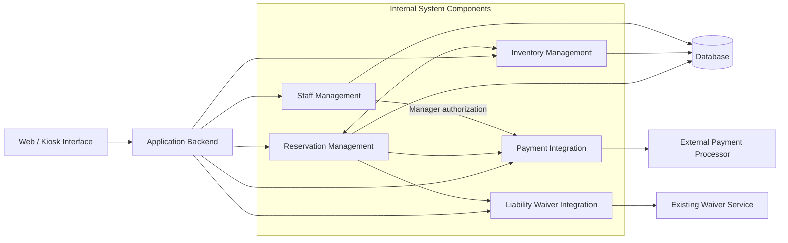
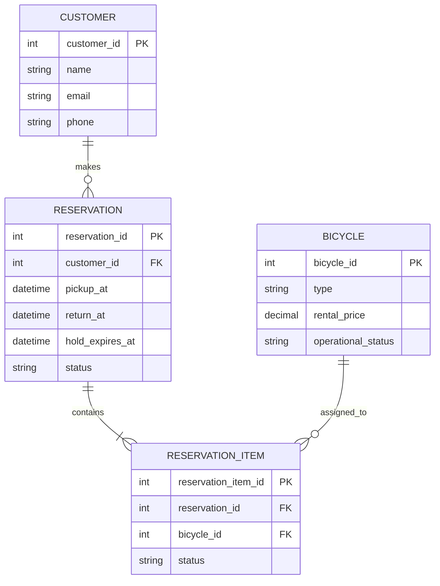
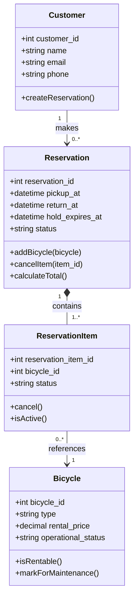

# Bend Bike Shop Technical Design Document

## 1. Overview

The Bend Bike Shop system is a web-based application that allows customers to browse available bicycles, make reservations, and pay for rentals online or through an in-store kiosk. Employees can manage reservations, process bicycle pickups and returns, record inspections, and handle additional charges. Managers can oversee bicycle inventory, manage maintenance, authorize refunds, and review rental activity.

The system will integrate with the shop's existing liability waiver service and an external payment processor. This document describes the technical design of the system, including its major components, their responsibilities, and how they interact.

## 2. Actors

The Bend Bike Shop system interacts with the following actors:

- **Customer:** Browses available bicycles, creates reservations, completes liability waivers, makes payments, and modifies or cancels existing reservations. Customers can use the system through the website or an in-store kiosk without creating an account.
- **Employee:** Manages bicycle pickups and returns, monitors active reservations, records bicycle inspections, processes additional charges, and reports maintenance issues.
- **Manager:** Oversees bicycle inventory and maintenance, reviews affected reservations, authorizes refunds, resolves customer disputes, and reviews rental activity.
- **Payment Processing System:** An external service that processes rental payments, additional charges, and authorized refunds.
- **External Liability Waiver Service:** The shop's existing third-party service that allows customers to review and electronically sign rental agreements and liability waivers.

## 3. Goals/Non-Goals

### 3.1 Goals

The primary goal of the Bend Bike Shop system is to simplify bicycle rentals for customers while providing employees and managers with the tools needed to manage daily rental operations.

The system will:

- Allow customers to browse available bicycles, make reservations, and complete payments online or through an in-store kiosk.
- Support guest reservations without requiring customers to create an account.
- Integrate with the shop's existing liability waiver service and an external payment processor.
- Allow customers to modify or cancel reservations, including partial cancellations.
- Allow employees to manage pickups, returns, inspections, late fees, and additional charges.
- Allow managers to manage bicycle inventory, maintenance, refunds, disputes, and rental activity.
- Keep bicycle availability updated to prevent conflicting reservations and exclude bicycles requiring maintenance.

### 3.2 Non-Goals

The following features are outside the scope of the Bend Bike Shop system:

- **Self-Service Pickups and Returns:** Customers must pick up and return bicycles with an employee present during normal business hours.
- **Automatic Replacement Charges:** The system will not automatically charge customers the replacement cost of lost or stolen bicycles. A manager must review these situations.
- **Kiosk Advertising:** The system will not display advertisements on rental kiosks.
- **Automated Marketing Campaigns:** The system will not manage advertising campaigns or promotional outreach.
- **New Liability Waiver System:** The system will use the shop's existing third-party waiver service rather than creating its own.
- **Automated Bicycle Recommendations:** The system will not automatically recommend bicycles based on customer preferences.

## 4. Constraints

The Bend Bike Shop system must operate within the following constraints:

1. **Existing Liability Waiver Service:** The system must integrate with Bend Bike Shop's existing third-party liability waiver service rather than developing a new one. Customers must complete the required waiver before proceeding to payment.
2. **Employee-Assisted Pickups and Returns:** All bicycle pickups and returns must be handled by an employee during normal business hours. The system will not support unattended or self-service bicycle exchanges.
3. **External Payment Processing:** Rental payments, additional charges, and refunds must be processed through an external payment processing service rather than handled directly by the application.
4. **Manager Authorization for Refunds:** Refunds must be reviewed and authorized by a manager before they are processed through the payment system.
5. **Bicycle Maintenance Restrictions:** Bicycles marked as requiring maintenance must be excluded from available rental inventory until they have been repaired, inspected, and returned to available status.

## 5. Assumptions

The following assumptions will guide the technical design of the Bend Bike Shop system until they are confirmed with Rodney Ridealot.

1. **Internet Connectivity:** Bend Bike Shop will have a reliable internet connection to support employee dashboards, in-store kiosks, and communication with external services.
2. **Existing Waiver Service Integration:** The shop's current liability waiver service provides a way for the application to verify whether a customer has completed the required waiver.
3. **Payment Processor Capabilities:** The external payment processor supports online payments, additional rental charges, and refunds through an integration that the application can use.
4. **Bicycle Inventory Information:** Bend Bike Shop will provide accurate bicycle inventory information, including unique identification numbers, bicycle types, rental prices, and maintenance status.
5. **Employee and Manager Accounts:** Each employee and manager will have an individual account with appropriate permissions based on their responsibilities.

## 6. Non-Functional Requirements

The Bend Bike Shop system must meet the following measurable requirements:

1. **Response Time:** The system must display bicycle availability search results within 2 seconds for at least 95% of requests while supporting up to 100 concurrent users.
2. **System Availability:** The application must maintain at least 99.5% uptime per calendar month, excluding scheduled maintenance.
3. **Concurrent Users:** The system must support at least 100 simultaneous users browsing bicycles, managing reservations, or accessing employee and manager dashboards without exceeding the defined response-time requirement.
4. **Session Security:** Employee and manager accounts must automatically expire after 15 minutes of inactivity, requiring users to authenticate again before accessing protected functions.
5. **Data Backup and Recovery:** The system must automatically back up reservation and inventory data at least once every 24 hours and support restoration of the latest successful backup within 4 hours.

## 7. Component Diagram and Description

The following diagram shows the major components of the Bend Bike Shop system and their relationships. Reservation Management coordinates waiver verification before payment and confirms a reservation after successful payment. Refund requests require verified manager authorization before Payment Integration submits them to the external processor. Payment transaction references and waiver completion statuses are stored with the associated reservation records; sensitive card details remain with the external payment processor.

| Component | Description |
|---|---|
| Web / Kiosk Interface | Allows customers, employees, and managers to interact with the system. |
| Application Backend | Handles requests from the interface and coordinates system functionality. |
| Reservation Management | Creates, modifies, cancels, and tracks bicycle reservations, including pickups, returns, and late fees. Coordinates waiver verification before payment, records payment and waiver statuses and transaction references, and identifies reservations affected by maintenance. Requires authorization verification before guests can access or change existing reservations. Tracks refund requests for manager approval. |
| Inventory Management | Tracks bicycles, availability, maintenance status, and rental pricing. Communicates maintenance-related unavailability to Reservation Management so managers can review affected bookings. |
| Payment Integration | Communicates with the external payment processor to handle payments, additional charges, and refunds. Processes refunds only after manager authorization has been verified. |
| Liability Waiver Integration | Connects to the existing waiver service to verify completed waivers before payment. |
| Staff Management | Handles employee and manager authentication, permissions, and access to administrative functions, including verification of manager permissions for refund approvals. |
| Database | Stores reservation, bicycle inventory, customer, and operational information, including payment transaction references and waiver completion statuses linked to reservations; it does not store customers’ payment card details. |
| External Payment Processor | Processes rental payments, additional charges, and authorized refunds. |
| Existing Waiver Service | Allows customers to electronically sign rental agreements and liability waivers. |

## 8. Data Model

The Bend Bike Shop system will use a relational database to store information about customers, bicycles, and reservations. The data model is designed to support multiple bicycles within a single reservation, partial cancellations, and bicycle availability tracking.

### 8.1 Entity Relationship Diagram

The Entity Relationship (ER) diagram contains four main entities:

- **Customer:** Stores customer contact information, including customers who make reservations without creating an account.
- **Reservation:** Stores reservation details, including rental dates and reservation status.
- **ReservationItem:** Connects individual bicycles to a reservation and allows customers to cancel specific bicycles without canceling the entire reservation.
- **Bicycle:** Stores bicycle information, rental prices, and maintenance status.

**Entity Relationships:**

- A customer can make multiple reservations, but each reservation belongs to one customer.
- A reservation contains one or more reservation items.
- Each reservation item references one bicycle.
- A bicycle can appear in multiple reservation items over time, provided the rental periods do not overlap.

The `hold_expires_at` field records when a pending reservation hold expires. Expired holds no longer block bicycle availability. The actual hold duration will be confirmed with Rodney.

The `ReservationItem` entity allows the system to support partial cancellations. For example, if a customer reserves three bicycles and decides to cancel one, the system can update that specific reservation item without affecting the remaining bicycles.

### 8.2 Class Diagram

The class diagram represents the main objects used by the application. Each class contains member variables that store information and methods that define its behavior.

The system uses four classes:

- **Customer:** Stores customer information and allows customers to create reservations.
- **Reservation:** Manages rental dates, reservation items, and cancellations.
- **ReservationItem:** Tracks an individual bicycle assigned to a reservation.
- **Bicycle:** Stores bicycle information and determines whether a bicycle is operational and eligible for rental.

**Class Relationships:**

- A `Customer` can create multiple `Reservation` objects.
- A `Reservation` contains one or more `ReservationItem` objects.
- Each `ReservationItem` references a `Bicycle` object.

**Method Responsibilities:**

- `createReservation()` creates a new reservation for a customer.
- `addBicycle()` adds a bicycle to an existing reservation.
- `cancelItem()` cancels a specific bicycle within a reservation.
- `calculateTotal()` calculates the total rental cost.
- `cancel()` updates an individual reservation item's status to canceled.
- `isActive()` checks whether a reservation item is still active.
- `isRentable()` checks whether a bicycle is operational and eligible for rental based on its maintenance status.
- `markForMaintenance()` marks a bicycle as requiring maintenance.

When the last active reservation item is canceled, the parent reservation changes to `CANCELED`. Canceled items remain recorded for reservation history.

The `Bicycle` class is responsible for tracking its operational status. However, determining whether a bicycle is available during specific rental dates requires checking existing reservations. That responsibility belongs to the Inventory Management component.

## 9. Interfaces

The Bend Bike Shop system uses interfaces to define how different components communicate. Each interface function specifies the required parameters, return type, purpose, preconditions, expected outcomes, guarantees, and additional notes.

The following functions represent six important operations within the system.

### 9.1 Data Types

The interfaces use primitive types such as `int`, `string`, `bool`, and `decimal`, along with the following non-primitive types:

| Type | Description |
|---|---|
| `datetime` | A date and time value used for rental pickup and return periods. |
| `ReservationItemStatus` | An enumeration with the values `ACTIVE` (still included in the reservation) and `CANCELED` (removed from the reservation). |
| `ReservationStatus` | An enumeration with the values `PENDING`, `CONFIRMED`, `CANCELED`, and `COMPLETED`. |
| `BicycleStatus` | An enumeration with the values `AVAILABLE` and `MAINTENANCE`. |
| `Reservation` | An object containing `reservation_id`, `customer_id`, `pickup_at`, `return_at`, `status`, and associated reservation items. |
| `Bicycle` | An object containing `bicycle_id`, `type`, `rental_price`, and `operational_status`. |
| `List[Bicycle]` | A collection containing zero or more `Bicycle` objects. |
| `List[int]` | A collection containing zero or more integer identifiers. |
| `PaymentResult` | An object containing `transaction_reference`, `amount`, and `status`. The status can be `SUCCESS`, `DECLINED`, `PENDING`, or `FAILED`. |

The function signatures below are conceptual interfaces and are not tied to a specific programming language or framework. Error handling and authorization checks will be enforced by the application backend. On failure, the backend will provide a specific error response or exception (for example, `ReservationNotFound`, `UnauthorizedAccess`, or `ItemAlreadyCanceled`) rather than relying on a generic `False` value alone. The existing function signatures describe normal return values.

### 9.2 getAvailableBicycles()

**Function Signature:**

`getAvailableBicycles(pickup_at: datetime, return_at: datetime) -> List[Bicycle]`

**Purpose:** Find bicycles available for the customer's selected rental period.

**Requires:** The pickup and return dates must be valid, and the return date must be later than the pickup date.

**Outcomes:** Returns a list of bicycles that are operational and have no conflicting active reservations during the requested rental period.

**Guarantees:** The function does not modify bicycle inventory or existing reservations.

**Notes:** Availability must be checked again when creating a reservation because another customer may reserve a bicycle between the initial search and checkout.

### 9.3 createReservation()

**Function Signature:**

`createReservation(customer_id: int, bicycle_ids: List[int], pickup_at: datetime, return_at: datetime) -> Reservation`

**Purpose:** Create a pending reservation for one or more bicycles selected by a customer.

**Requires:** The customer must have valid contact information, at least one bicycle must be selected, the rental dates must be valid, and the selected bicycles must be available for the requested period.

**Outcomes:** Creates a reservation with the status `PENDING` and associates the selected bicycles with individual reservation items.

**Guarantees:** The system prevents overlapping active bicycle allocations when creating the reservation. The reservation is not marked `CONFIRMED` until the required waiver has been verified and payment has succeeded.

**Notes:** Pending reservations use temporary holds tracked by `hold_expires_at` that expire if checkout is not completed. Expired holds no longer block availability. The hold duration must be confirmed with Rodney. Customers may create reservations without registering an account.

### 9.4 verifyWaiver()

**Function Signature:**

`verifyWaiver(reservation_id: int) -> bool`

**Purpose:** Verify that the customer has completed the required liability waiver through Bend Bike Shop's existing third-party waiver service.

**Requires:** The reservation must exist, and the external waiver service must be accessible.

**Outcomes:** Returns `True` when the external service confirms that the required waiver has been completed. Otherwise, returns `False`.

**Guarantees:** The system does not authorize payment until waiver completion has been verified.

**Notes:** The application uses the existing waiver service rather than implementing its own waiver system. The verification reference and completion status are associated with the reservation.

### 9.5 processPayment()

**Function Signature:**

`processPayment(reservation_id: int, amount: decimal) -> PaymentResult`

**Purpose:** Process the rental payment using the external payment processor.

**Requires:** The reservation must exist, the liability waiver must be verified, and the payment amount must match the server-calculated rental total.

**Outcomes:** Returns a `PaymentResult` indicating whether the payment succeeded, was declined, is pending, or failed.

**Guarantees:** A reservation is confirmed only after successful payment. The application does not store customers' full payment card information.

**Notes:** The external payment processor handles payment transactions. Transaction references and payment statuses are stored with the reservation. If a payment request times out, the system checks the transaction status before attempting another charge to prevent duplicate payments.

### 9.6 cancelReservationItem()

**Function Signature:**

`cancelReservationItem(reservation_id: int, item_id: int) -> bool`

**Purpose:** Allow a customer to cancel an individual bicycle within an existing reservation without canceling the entire reservation.

**Requires:** The reservation and reservation item must exist, the item must be eligible for cancellation, and the customer must have verified authorization to modify the reservation.

**Outcomes:** Changes the selected reservation item's status to `CANCELED`, releases its bicycle allocation, and updates the reservation information. Returns `True` when the cancellation succeeds and `False` when it cannot be completed.

**Guarantees:** Other active reservation items remain unchanged. If the canceled item was the last active item, the parent reservation changes to `CANCELED`. Any refund resulting from the cancellation requires manager approval before processing.

**Notes:** Guest customers must verify their identity using an email verification code before modifying reservations. Cancellation fees and refund amounts follow shop policies that must be confirmed with Rodney.

### 9.7 markBicycleForMaintenance()

**Function Signature:**

`markBicycleForMaintenance(bicycle_id: int, manager_id: int) -> bool`

**Purpose:** Allow a manager to mark a bicycle as requiring maintenance so it cannot be rented until repairs and inspection are completed.

**Requires:** The bicycle must exist, and the requesting staff member must have manager permissions.

**Outcomes:** Updates the bicycle's operational status to `MAINTENANCE` and returns `True` when successful. Returns `False` if the operation cannot be completed.

**Guarantees:** A bicycle marked for maintenance is excluded from new rental availability searches and cannot receive new reservation allocations.

**Notes:** The system identifies existing reservations that may be affected by the maintenance status change so a manager can review them. The bicycle can return to available status only after repairs, inspection, and manager approval.

## 10. Invariants

Invariants are conditions that must remain true throughout the operation of the Bend Bike Shop system. These rules help maintain data integrity and ensure the application behaves consistently when customers, employees, and managers interact with it.

The system will enforce the following four invariants.

### 10.1 No Overlapping Bicycle Reservations

A bicycle cannot be allocated to more than one active reservation for overlapping rental periods.

When a customer creates a reservation, the system must check whether the selected bicycle is already reserved during the requested dates. This check must also occur when the reservation is created, not just when the customer searches for available bicycles.

This prevents two customers from reserving the same bicycle for the same period. Pending reservations with unexpired `hold_expires_at` values and confirmed reservations must both be considered when checking for conflicts. Expired holds do not block availability.

### 10.2 Reservation Confirmation Requirements

A reservation cannot have a status of `CONFIRMED` unless the required liability waiver has been verified and the rental payment has been successfully processed.

The system must verify waiver completion through Bend Bike Shop's existing external waiver service before accepting payment. The payment processor must then confirm that the payment was successful before the reservation status changes from `PENDING` to `CONFIRMED`.

This ensures that customers cannot receive confirmed reservations without completing the required steps.

### 10.3 Bicycle Maintenance Restrictions

A bicycle with an operational status of `MAINTENANCE` cannot be assigned to a new reservation.

When a manager marks a bicycle as requiring maintenance, the system must immediately exclude it from new availability searches and reject attempts to allocate it to new reservations.

The bicycle can return to rentable inventory only after repairs and inspection have been completed and a manager changes its operational status to `AVAILABLE`.

Existing reservations involving the bicycle must be identified for manager review.

### 10.4 Manager Authorization for Refunds

Every refund submitted to the external payment processor must have prior authorization from a manager.

Before processing a refund, the system must verify that an authenticated manager has approved the refund request.

Employees may identify billing issues and refer disputes to a manager, but they cannot independently authorize refunds.

This ensures that refund decisions follow Bend Bike Shop's authorization requirements and prevents unauthorized refunds.

## 11. Failure Modes

Failure modes describe situations where the Bend Bike Shop system may not operate as expected. Identifying these failures helps developers understand potential problems and determine how the application should respond.

The following table identifies four possible failure modes, their causes, effects, and how the system should handle them.

| Failure Mode | Cause | Effect | System Response |
|---|---|---|---|
| Bicycle Reservation Conflict | Two customers attempt to reserve the same bicycle for overlapping rental periods. | The bicycle could be double-booked, causing problems when customers arrive for pickup. | The system checks availability again when creating a reservation and prevents overlapping active allocations. The customer receives a message asking them to select another bicycle. |
| Payment Processor Failure | The external payment processor declines a transaction, becomes unavailable, or does not respond in time. | The customer cannot complete checkout, or the payment status becomes uncertain. | The system does not confirm the reservation until payment success is verified. If the payment status is unknown, the system checks the existing transaction before allowing another payment attempt to prevent duplicate charges. |
| Liability Waiver Service Unavailable | The third-party liability waiver service experiences an outage or cannot verify a completed waiver. | The system cannot confirm whether the customer has completed the required waiver. | The system keeps the reservation pending and prevents payment until waiver completion can be verified. The customer receives an error message and can retry when the service becomes available. |
| Database Connection Failure | The database becomes unavailable because of a network problem, server failure, or other technical issue. | The application cannot reliably retrieve or update reservations, bicycle inventory, or customer information. | The system prevents new reservations and changes that require database access. It displays an error message and logs the failure. Once the connection is restored, normal operations can resume after the system verifies data consistency. |

These failure modes help protect the system from incorrect reservations, unauthorized checkout, duplicate payments, and inconsistent data. They also support the invariants defined in Section 10.