# Bend Bike Shop — Project 6: Estimation and Scheduling

**Team:** 2 developers. **Planning start:** 2026-11-09 (illustrative). **Working days:** Monday–Friday, 8 hours/day.

## Scheduling assumptions

For a practical two-developer Gantt, each task is assigned to one developer and its PERT mean is rounded **up** to whole working days; tasks assigned to the same developer do not overlap. Tasks start only after all listed predecessors finish. The fixed post-launch support window is 10 working days assigned to D1; D2 may assist as needed. This is a conservative, baseline rather than a mathematically optimized two-person schedule.

**Two-developer Gantt baseline:** 183 working days (~36.6 work-weeks); starts 2026-11-09, finishes by 2027-07-22 (exclusive endpoint).

## 1. Work Breakdown Structure (WBS)

- 1. Bend Bike Shop System
  - 1.1 Planning and design
    - 1.1.1 Requirements Gathering
      - 1.1.1.1 Meet with Rodney to identify business needs
      - 1.1.1.2 Develop the functional specification
      - 1.1.1.3 Confirm project scope and requirements
    - 1.1.2 User Interface Design
      - 1.1.2.1 Create customer, employee, and manager wireframes
      - 1.1.2.2 Develop the interactive prototype
      - 1.1.2.3 Review and refine the interface design
    - 1.1.3 Technical Design
      - 1.1.3.1 Define system architecture and components
      - 1.1.3.2 Design database models and interfaces
      - 1.1.3.3 Document invariants and failure modes
    - 1.1.4 Development Preparation
      - 1.1.4.1 Configure GitHub repository and development environments
      - 1.1.4.2 Establish coding and testing standards
      - 1.1.4.3 Confirm external service integration requirements
  - 1.2 Database and backend
    - 1.2.1 Database Implementation
      - 1.2.1.1 Create relational database schema
      - 1.2.1.2 Implement data relationships and constraints
      - 1.2.1.3 Configure database access and migrations
    - 1.2.2 Reservation Management
      - 1.2.2.1 Implement availability searches and conflict prevention
      - 1.2.2.2 Implement reservation creation and temporary holds
      - 1.2.2.3 Implement reservation modification and cancellation
    - 1.2.3 Inventory Management
      - 1.2.3.1 Implement bicycle inventory records
      - 1.2.3.2 Implement maintenance status and availability restrictions
      - 1.2.3.3 Identify reservations affected by maintenance
    - 1.2.4 Backend Services
      - 1.2.4.1 Develop backend API endpoints
      - 1.2.4.2 Implement business rules and validation
      - 1.2.4.3 Implement error handling and database transaction safeguards
  - 1.3 Customer website and kiosk
    - 1.3.1 Customer Interface
      - 1.3.1.1 Develop homepage and navigation
      - 1.3.1.2 Develop bicycle browsing and filtering interface
      - 1.3.1.3 Develop bicycle details and rental date selection
    - 1.3.2 Reservation Interface
      - 1.3.2.1 Develop bicycle selection and reservation summary
      - 1.3.2.2 Develop customer information and checkout forms
      - 1.3.2.3 Develop reservation confirmation and error screens
    - 1.3.3 Reservation Management Interface
      - 1.3.3.1 Develop reservation lookup interface
      - 1.3.3.2 Develop reservation modification interface
      - 1.3.3.3 Develop partial and full cancellation interface
    - 1.3.4 Kiosk Interface
      - 1.3.4.1 Adapt customer interface for kiosk use
      - 1.3.4.2 Implement kiosk session reset and privacy protections
      - 1.3.4.3 Test kiosk navigation and usability
  - 1.4 Payments and integrations
    - 1.4.1 Liability Waiver Integration
      - 1.4.1.1 Connect to existing liability waiver service
      - 1.4.1.2 Implement waiver completion verification
      - 1.4.1.3 Handle waiver service errors and outages
    - 1.4.2 Payment Processing
      - 1.4.2.1 Integrate external payment processor
      - 1.4.2.2 Implement rental payment processing
      - 1.4.2.3 Implement payment status tracking and duplicate-charge prevention
    - 1.4.3 Refunds and Additional Charges
      - 1.4.3.1 Implement manager-approved refund processing
      - 1.4.3.2 Implement late fees and additional rental charges
      - 1.4.3.3 Record payment transactions and refund history
    - 1.4.4 Checkout Integration
      - 1.4.4.1 Connect reservation checkout to waiver verification
      - 1.4.4.2 Connect verified waivers to payment processing
      - 1.4.4.3 Confirm reservations only after successful payment
  - 1.5 Employee and manager tools
    - 1.5.1 Employee Rental Management
      - 1.5.1.1 Develop employee reservation dashboard
      - 1.5.1.2 Implement bicycle pickup and return workflows
      - 1.5.1.3 Implement bicycle inspections, damage reporting, notes, and photo uploads
    - 1.5.2 Manager Administration
      - 1.5.2.1 Develop manager dashboard and rental activity reports
      - 1.5.2.2 Implement bicycle inventory and maintenance management
      - 1.5.2.3 Implement refund approval and dispute management interface
    - 1.5.3 Authentication and Authorization
      - 1.5.3.1 Implement employee and manager login
      - 1.5.3.2 Implement role-based permissions and access controls
      - 1.5.3.3 Implement session expiration and secure logout
    - 1.5.4 Guest Verification and Security
      - 1.5.4.1 Implement guest email verification codes
      - 1.5.4.2 Protect guest reservation lookup and modifications
      - 1.5.4.3 Implement security logging, audit records, and secure inspection photo storage
  - 1.6 Testing deployment and support
    - 1.6.1 Functional Testing
      - 1.6.1.1 Develop and run unit tests
      - 1.6.1.2 Test reservation, payment, and waiver integrations
      - 1.6.1.3 Test employee, manager, and kiosk workflows
    - 1.6.2 Performance and Security Testing
      - 1.6.2.1 Test performance with 100 concurrent users
      - 1.6.2.2 Test authentication, authorization, and session security
      - 1.6.2.3 Test reservation conflicts and failure recovery
    - 1.6.3 Infrastructure and Deployment
      - 1.6.3.1 Configure production hosting and database
      - 1.6.3.2 Implement automated backups and recovery procedures
      - 1.6.3.3 Configure deployment pipeline and monitoring
    - 1.6.4 Launch and Validation
      - 1.6.4.1 Conduct user acceptance testing with shop staff
      - 1.6.4.2 Resolve launch-blocking defects
      - 1.6.4.3 Deploy application and verify production operation
    - 1.6.5 Post-Launch Support
      - 1.6.5.1 Provide two weeks of monitoring, bug fixes, and staff assistance

## 2. PERT Estimates

Formula: `(O + 4*M + P) / 6`.

| WBS | Task | O | M | P | PERT |
|---|---|---:|---:|---:|---:|
| 1.1.1.1 | Meet with Rodney to identify business needs | 1 | 2 | 3 | 2.00 |
| 1.1.1.2 | Develop the functional specification | 1 | 2 | 4 | 2.17 |
| 1.1.1.3 | Confirm project scope and requirements | 1 | 2 | 3 | 2.00 |
| 1.1.2.1 | Create customer, employee, and manager wireframes | 2 | 4 | 6 | 4.00 |
| 1.1.2.2 | Develop the interactive prototype | 2 | 3 | 5 | 3.17 |
| 1.1.2.3 | Review and refine the interface design | 1 | 2 | 4 | 2.17 |
| 1.1.3.1 | Define system architecture and components | 2 | 3 | 5 | 3.17 |
| 1.1.3.2 | Design database models and interfaces | 2 | 4 | 6 | 4.00 |
| 1.1.3.3 | Document invariants and failure modes | 1 | 2 | 4 | 2.17 |
| 1.1.4.1 | Configure GitHub repository and development environments | 1 | 2 | 3 | 2.00 |
| 1.1.4.2 | Establish coding and testing standards | 1 | 2 | 3 | 2.00 |
| 1.1.4.3 | Confirm external service integration requirements | 1 | 3 | 5 | 3.00 |
| 1.2.1.1 | Create relational database schema | 2 | 4 | 7 | 4.17 |
| 1.2.1.2 | Implement data relationships and constraints | 2 | 3 | 6 | 3.33 |
| 1.2.1.3 | Configure database access and migrations | 1 | 3 | 5 | 3.00 |
| 1.2.2.1 | Implement availability searches and conflict prevention | 4 | 7 | 12 | 7.33 |
| 1.2.2.2 | Implement reservation creation and temporary holds | 3 | 6 | 10 | 6.17 |
| 1.2.2.3 | Implement reservation modification and cancellation | 3 | 5 | 9 | 5.33 |
| 1.2.3.1 | Implement bicycle inventory records | 2 | 3 | 5 | 3.17 |
| 1.2.3.2 | Implement maintenance status and availability restrictions | 2 | 4 | 7 | 4.17 |
| 1.2.3.3 | Identify reservations affected by maintenance | 2 | 3 | 6 | 3.33 |
| 1.2.4.1 | Develop backend API endpoints | 4 | 7 | 12 | 7.33 |
| 1.2.4.2 | Implement business rules and validation | 3 | 5 | 9 | 5.33 |
| 1.2.4.3 | Implement error handling and database transaction safeguards | 3 | 5 | 9 | 5.33 |
| 1.3.1.1 | Develop homepage and navigation | 1 | 2 | 4 | 2.17 |
| 1.3.1.2 | Develop bicycle browsing and filtering interface | 2 | 4 | 7 | 4.17 |
| 1.3.1.3 | Develop bicycle details and rental date selection | 2 | 3 | 6 | 3.33 |
| 1.3.2.1 | Develop bicycle selection and reservation summary | 2 | 4 | 7 | 4.17 |
| 1.3.2.2 | Develop customer information and checkout forms | 2 | 4 | 7 | 4.17 |
| 1.3.2.3 | Develop reservation confirmation and error screens | 1 | 3 | 5 | 3.00 |
| 1.3.3.1 | Develop reservation lookup interface | 1 | 2 | 4 | 2.17 |
| 1.3.3.2 | Develop reservation modification interface | 2 | 3 | 6 | 3.33 |
| 1.3.3.3 | Develop partial and full cancellation interface | 2 | 3 | 6 | 3.33 |
| 1.3.4.1 | Adapt customer interface for kiosk use | 2 | 4 | 7 | 4.17 |
| 1.3.4.2 | Implement kiosk session reset and privacy protections | 2 | 3 | 6 | 3.33 |
| 1.3.4.3 | Test kiosk navigation and usability | 1 | 2 | 4 | 2.17 |
| 1.4.1.1 | Connect to existing liability waiver service | 2 | 4 | 8 | 4.33 |
| 1.4.1.2 | Implement waiver completion verification | 2 | 4 | 7 | 4.17 |
| 1.4.1.3 | Handle waiver service errors and outages | 2 | 3 | 6 | 3.33 |
| 1.4.2.1 | Integrate external payment processor | 3 | 5 | 9 | 5.33 |
| 1.4.2.2 | Implement rental payment processing | 3 | 5 | 9 | 5.33 |
| 1.4.2.3 | Implement payment status tracking and duplicate-charge prevention | 3 | 6 | 11 | 6.33 |
| 1.4.3.1 | Implement manager-approved refund processing | 3 | 5 | 9 | 5.33 |
| 1.4.3.2 | Implement late fees and additional rental charges | 2 | 4 | 7 | 4.17 |
| 1.4.3.3 | Record payment transactions and refund history | 2 | 3 | 6 | 3.33 |
| 1.4.4.1 | Connect reservation checkout to waiver verification | 2 | 3 | 6 | 3.33 |
| 1.4.4.2 | Connect verified waivers to payment processing | 2 | 3 | 6 | 3.33 |
| 1.4.4.3 | Confirm reservations only after successful payment | 2 | 4 | 7 | 4.17 |
| 1.5.1.1 | Develop employee reservation dashboard | 2 | 4 | 7 | 4.17 |
| 1.5.1.2 | Implement bicycle pickup and return workflows | 3 | 5 | 9 | 5.33 |
| 1.5.1.3 | Implement bicycle inspections, damage reporting, notes, and photo uploads | 4 | 7 | 12 | 7.33 |
| 1.5.2.1 | Develop manager dashboard and rental activity reports | 3 | 5 | 9 | 5.33 |
| 1.5.2.2 | Implement bicycle inventory and maintenance management | 3 | 5 | 9 | 5.33 |
| 1.5.2.3 | Implement refund approval and dispute management interface | 3 | 5 | 9 | 5.33 |
| 1.5.3.1 | Implement employee and manager login | 2 | 4 | 7 | 4.17 |
| 1.5.3.2 | Implement role-based permissions and access controls | 3 | 5 | 9 | 5.33 |
| 1.5.3.3 | Implement session expiration and secure logout | 1 | 2 | 4 | 2.17 |
| 1.5.4.1 | Implement guest email verification codes | 2 | 4 | 7 | 4.17 |
| 1.5.4.2 | Protect guest reservation lookup and modifications | 2 | 4 | 7 | 4.17 |
| 1.5.4.3 | Implement security logging, audit records, and secure inspection photo storage | 4 | 6 | 11 | 6.50 |
| 1.6.1.1 | Develop and run unit tests | 4 | 7 | 12 | 7.33 |
| 1.6.1.2 | Test reservation, payment, and waiver integrations | 3 | 5 | 9 | 5.33 |
| 1.6.1.3 | Test employee, manager, and kiosk workflows | 3 | 5 | 9 | 5.33 |
| 1.6.2.1 | Test performance with 100 concurrent users | 2 | 4 | 7 | 4.17 |
| 1.6.2.2 | Test authentication, authorization, and session security | 3 | 5 | 9 | 5.33 |
| 1.6.2.3 | Test reservation conflicts and failure recovery | 3 | 5 | 9 | 5.33 |
| 1.6.3.1 | Configure production hosting and database | 2 | 4 | 7 | 4.17 |
| 1.6.3.2 | Implement automated backups and recovery procedures | 2 | 4 | 7 | 4.17 |
| 1.6.3.3 | Configure deployment pipeline and monitoring | 2 | 4 | 7 | 4.17 |
| 1.6.4.1 | Conduct user acceptance testing with shop staff | 2 | 4 | 7 | 4.17 |
| 1.6.4.2 | Resolve launch-blocking defects | 3 | 6 | 12 | 6.50 |
| 1.6.4.3 | Deploy application and verify production operation | 1 | 2 | 4 | 2.17 |
| 1.6.5.1 | Provide two weeks of monitoring, bug fixes, and staff assistance | 10 | 10 | 10 | 10.00 |

**Sum of expected task durations:** 309.33 working days. This is not the elapsed project duration.

## 3. Monte Carlo Simulation

This is a **dependency-only schedule**, not a resource-constrained two-developer commitment. The two-week post-launch support task is fixed at 10 working days.

| Statistic | Working days |
|---|---:|
| Mean | 93.57 |
| P50 | 93.51 |
| P80 | 96.89 |
| P90 | 98.68 |
| P95 | 100.27 |
| Deterministic CPM | 92.00 |

Dependency and CPM table: `bend_bike_shop_dependencies_cpm.csv`.

## 4. Critical Path Method (CPM)

The CPM table uses continuous PERT means and dependency precedence **without** a two-developer capacity limit. Its 92.00 working-day critical path is therefore shorter than the resource-constrained Gantt. Zero-slack tasks are critical in this dependency-only model.

| WBS | Duration | Dependencies | ES | EF | LS | LF | Slack |
|---|---:|---|---:|---:|---:|---:|---:|
| 1.1.1.1 | 2.00 | — | 0.00 | 2.00 | -0.00 | 2.00 | -0.00 |
| 1.1.1.2 | 2.17 | 1.1.1.1 | 2.00 | 4.17 | 2.00 | 4.17 | -0.00 |
| 1.1.1.3 | 2.00 | 1.1.1.2 | 4.17 | 6.17 | 4.17 | 6.17 | -0.00 |
| 1.1.2.1 | 4.00 | 1.1.1.3 | 6.17 | 10.17 | 18.50 | 22.50 | 12.33 |
| 1.1.2.2 | 3.17 | 1.1.2.1 | 10.17 | 13.33 | 22.50 | 25.67 | 12.33 |
| 1.1.2.3 | 2.17 | 1.1.2.2 | 13.33 | 15.50 | 25.67 | 27.83 | 12.33 |
| 1.1.3.1 | 3.17 | 1.1.1.3 | 6.17 | 9.33 | 6.17 | 9.33 | -0.00 |
| 1.1.3.2 | 4.00 | 1.1.3.1 | 9.33 | 13.33 | 9.33 | 13.33 | -0.00 |
| 1.1.3.3 | 2.17 | 1.1.3.2 | 13.33 | 15.50 | 89.83 | 92.00 | 76.50 |
| 1.1.4.1 | 2.00 | 1.1.3.1 | 9.33 | 11.33 | 11.33 | 13.33 | 2.00 |
| 1.1.4.2 | 2.00 | 1.1.4.1 | 11.33 | 13.33 | 24.67 | 26.67 | 13.33 |
| 1.1.4.3 | 3.00 | 1.1.3.1 | 9.33 | 12.33 | 31.00 | 34.00 | 21.67 |
| 1.2.1.1 | 4.17 | 1.1.3.2; 1.1.4.1 | 13.33 | 17.50 | 13.33 | 17.50 | -0.00 |
| 1.2.1.2 | 3.33 | 1.2.1.1 | 17.50 | 20.83 | 17.50 | 20.83 | -0.00 |
| 1.2.1.3 | 3.00 | 1.2.1.2 | 20.83 | 23.83 | 20.83 | 23.83 | -0.00 |
| 1.2.2.1 | 7.33 | 1.2.1.3; 1.2.3.1 | 27.00 | 34.33 | 27.00 | 34.33 | -0.00 |
| 1.2.2.2 | 6.17 | 1.2.2.1 | 34.33 | 40.50 | 34.33 | 40.50 | -0.00 |
| 1.2.2.3 | 5.33 | 1.2.2.2 | 40.50 | 45.83 | 49.00 | 54.33 | 8.50 |
| 1.2.3.1 | 3.17 | 1.2.1.3 | 23.83 | 27.00 | 23.83 | 27.00 | -0.00 |
| 1.2.3.2 | 4.17 | 1.2.3.1 | 27.00 | 31.17 | 56.33 | 60.50 | 29.33 |
| 1.2.3.3 | 3.33 | 1.2.3.2; 1.2.2.2 | 40.50 | 43.83 | 60.50 | 63.83 | 20.00 |
| 1.2.4.1 | 7.33 | 1.2.1.3; 1.1.4.2 | 23.83 | 31.17 | 26.67 | 34.00 | 2.83 |
| 1.2.4.2 | 5.33 | 1.2.4.1; 1.2.2.2 | 40.50 | 45.83 | 40.50 | 45.83 | -0.00 |
| 1.2.4.3 | 5.33 | 1.2.4.2 | 45.83 | 51.17 | 45.83 | 51.17 | -0.00 |
| 1.3.1.1 | 2.17 | 1.1.2.3; 1.1.4.1 | 15.50 | 17.67 | 27.83 | 30.00 | 12.33 |
| 1.3.1.2 | 4.17 | 1.3.1.1 | 17.67 | 21.83 | 30.00 | 34.17 | 12.33 |
| 1.3.1.3 | 3.33 | 1.3.1.2 | 21.83 | 25.17 | 34.17 | 37.50 | 12.33 |
| 1.3.2.1 | 4.17 | 1.3.1.3 | 25.17 | 29.33 | 37.50 | 41.67 | 12.33 |
| 1.3.2.2 | 4.17 | 1.3.2.1 | 29.33 | 33.50 | 41.67 | 45.83 | 12.33 |
| 1.3.2.3 | 3.00 | 1.3.2.2 | 33.50 | 36.50 | 45.83 | 48.83 | 12.33 |
| 1.3.3.1 | 2.17 | 1.3.1.1 | 17.67 | 19.83 | 83.17 | 85.33 | 65.50 |
| 1.3.3.2 | 3.33 | 1.3.3.1 | 19.83 | 23.17 | 85.33 | 88.67 | 65.50 |
| 1.3.3.3 | 3.33 | 1.3.3.2 | 23.17 | 26.50 | 88.67 | 92.00 | 65.50 |
| 1.3.4.1 | 4.17 | 1.3.2.3 | 36.50 | 40.67 | 48.83 | 53.00 | 12.33 |
| 1.3.4.2 | 3.33 | 1.3.4.1 | 40.67 | 44.00 | 53.00 | 56.33 | 12.33 |
| 1.3.4.3 | 2.17 | 1.3.4.2 | 44.00 | 46.17 | 56.33 | 58.50 | 12.33 |
| 1.4.1.1 | 4.33 | 1.1.4.3; 1.2.4.1 | 31.17 | 35.50 | 39.17 | 43.50 | 8.00 |
| 1.4.1.2 | 4.17 | 1.4.1.1 | 35.50 | 39.67 | 43.50 | 47.67 | 8.00 |
| 1.4.1.3 | 3.33 | 1.4.1.2 | 39.67 | 43.00 | 88.67 | 92.00 | 49.00 |
| 1.4.2.1 | 5.33 | 1.1.4.3; 1.2.4.1 | 31.17 | 36.50 | 34.00 | 39.33 | 2.83 |
| 1.4.2.2 | 5.33 | 1.4.2.1 | 36.50 | 41.83 | 39.33 | 44.67 | 2.83 |
| 1.4.2.3 | 6.33 | 1.4.2.2 | 41.83 | 48.17 | 44.67 | 51.00 | 2.83 |
| 1.4.3.1 | 5.33 | 1.4.2.2; 1.5.3.2 | 41.83 | 47.17 | 47.83 | 53.17 | 6.00 |
| 1.4.3.2 | 4.17 | 1.4.2.2; 1.5.1.2 | 45.83 | 50.00 | 61.67 | 65.83 | 15.83 |
| 1.4.3.3 | 3.33 | 1.4.3.1; 1.4.3.2 | 50.00 | 53.33 | 65.83 | 69.17 | 15.83 |
| 1.4.4.1 | 3.33 | 1.4.1.2; 1.3.2.2 | 39.67 | 43.00 | 47.67 | 51.00 | 8.00 |
| 1.4.4.2 | 3.33 | 1.4.4.1; 1.4.2.3 | 48.17 | 51.50 | 51.00 | 54.33 | 2.83 |
| 1.4.4.3 | 4.17 | 1.4.4.2; 1.2.2.2 | 51.50 | 55.67 | 54.33 | 58.50 | 2.83 |
| 1.5.1.1 | 4.17 | 1.2.4.1; 1.5.3.1 | 31.17 | 35.33 | 40.50 | 44.67 | 9.33 |
| 1.5.1.2 | 5.33 | 1.5.1.1; 1.2.2.2 | 40.50 | 45.83 | 44.67 | 50.00 | 4.17 |
| 1.5.1.3 | 7.33 | 1.5.1.2 | 45.83 | 53.17 | 50.00 | 57.33 | 4.17 |
| 1.5.2.1 | 5.33 | 1.5.3.1; 1.2.4.1 | 31.17 | 36.50 | 47.83 | 53.17 | 16.67 |
| 1.5.2.2 | 5.33 | 1.5.2.1; 1.2.3.2 | 36.50 | 41.83 | 86.67 | 92.00 | 50.17 |
| 1.5.2.3 | 5.33 | 1.5.2.1; 1.4.3.1 | 47.17 | 52.50 | 53.17 | 58.50 | 6.00 |
| 1.5.3.1 | 4.17 | 1.2.1.3; 1.1.4.2 | 23.83 | 28.00 | 36.33 | 40.50 | 12.50 |
| 1.5.3.2 | 5.33 | 1.5.3.1 | 28.00 | 33.33 | 42.50 | 47.83 | 14.50 |
| 1.5.3.3 | 2.17 | 1.5.3.2 | 33.33 | 35.50 | 49.00 | 51.17 | 15.67 |
| 1.5.4.1 | 4.17 | 1.2.4.1; 1.1.4.3 | 31.17 | 35.33 | 50.17 | 54.33 | 19.00 |
| 1.5.4.2 | 4.17 | 1.5.4.1; 1.2.2.3 | 45.83 | 50.00 | 54.33 | 58.50 | 8.50 |
| 1.5.4.3 | 6.50 | 1.5.1.3; 1.5.3.2 | 53.17 | 59.67 | 57.33 | 63.83 | 4.17 |
| 1.6.1.1 | 7.33 | 1.2.4.3; 1.3.2.3; 1.5.3.3 | 51.17 | 58.50 | 51.17 | 58.50 | -0.00 |
| 1.6.1.2 | 5.33 | 1.6.1.1; 1.4.4.3 | 58.50 | 63.83 | 58.50 | 63.83 | -0.00 |
| 1.6.1.3 | 5.33 | 1.6.1.1; 1.5.2.3; 1.3.4.3; 1.5.4.2 | 58.50 | 63.83 | 58.50 | 63.83 | -0.00 |
| 1.6.2.1 | 4.17 | 1.6.1.2 | 63.83 | 68.00 | 65.00 | 69.17 | 1.17 |
| 1.6.2.2 | 5.33 | 1.6.1.3; 1.5.4.3 | 63.83 | 69.17 | 63.83 | 69.17 | -0.00 |
| 1.6.2.3 | 5.33 | 1.6.1.2; 1.2.3.3 | 63.83 | 69.17 | 63.83 | 69.17 | -0.00 |
| 1.6.3.1 | 4.17 | 1.1.4.1; 1.2.1.3 | 23.83 | 28.00 | 56.67 | 60.83 | 32.83 |
| 1.6.3.2 | 4.17 | 1.6.3.1 | 28.00 | 32.17 | 60.83 | 65.00 | 32.83 |
| 1.6.3.3 | 4.17 | 1.6.3.2 | 32.17 | 36.33 | 65.00 | 69.17 | 32.83 |
| 1.6.4.1 | 4.17 | 1.6.1.3; 1.6.2.1; 1.6.2.2; 1.6.2.3; 1.6.3.3; 1.4.3.3 | 69.17 | 73.33 | 69.17 | 73.33 | 0.00 |
| 1.6.4.2 | 6.50 | 1.6.4.1 | 73.33 | 79.83 | 73.33 | 79.83 | 0.00 |
| 1.6.4.3 | 2.17 | 1.6.4.2 | 79.83 | 82.00 | 79.83 | 82.00 | 0.00 |
| 1.6.5.1 | 10.00 | 1.6.4.3 | 82.00 | 92.00 | 82.00 | 92.00 | 0.00 |

## 5. Two-Developer Mermaid Gantt Chart

This chart uses explicit dates and rounded-up durations; task labels identify assigned developer (D1 or D2). `excludes weekends` skips Saturdays and Sundays. Dependencies are honored in the computed start dates.

```mermaid
gantt
    title Bend Bike Shop - Two Developer Baseline
    dateFormat YYYY-MM-DD
    axisFormat %b %d
    excludes weekends
    tickInterval 2week
    section Planning and design
    1.1.1.1 Meet with Rodney to identify business needs (D1) :t1_1_1_1, 2026-11-09, 2d
    1.1.1.2 Develop the functional specification (D1) :t1_1_1_2, 2026-11-11, 3d
    1.1.1.3 Confirm project scope and requirements (D1) :t1_1_1_3, 2026-11-16, 2d
    1.1.2.1 Create customer employee and manager wireframes (D2) :t1_1_2_1, 2026-11-18, 4d
    1.1.2.2 Develop the interactive prototype (D2) :t1_1_2_2, 2026-11-26, 4d
    1.1.2.3 Review and refine the interface design (D2) :t1_1_2_3, 2026-12-02, 3d
    1.1.3.1 Define system architecture and components (D1) :t1_1_3_1, 2026-11-18, 4d
    1.1.3.2 Design database models and interfaces (D1) :t1_1_3_2, 2026-11-24, 4d
    1.1.3.3 Document invariants and failure modes (D2) :t1_1_3_3, 2027-07-14, 3d
    1.1.4.1 Configure GitHub repository and development en... (D2) :t1_1_4_1, 2026-11-24, 2d
    1.1.4.2 Establish coding and testing standards (D2) :t1_1_4_2, 2026-12-07, 2d
    1.1.4.3 Confirm external service integration requirements (D2) :t1_1_4_3, 2026-12-31, 3d
    section Database and backend
    1.2.1.1 Create relational database schema (D1) :t1_2_1_1, 2026-11-30, 5d
    1.2.1.2 Implement data relationships and constraints (D1) :t1_2_1_2, 2026-12-07, 4d
    1.2.1.3 Configure database access and migrations (D1) :t1_2_1_3, 2026-12-11, 3d
    1.2.2.1 Implement availability searches and conflict p... (D1) :t1_2_2_1, 2026-12-22, 8d
    1.2.2.2 Implement reservation creation and temporary h... (D1) :t1_2_2_2, 2027-01-07, 7d
    1.2.2.3 Implement reservation modification and cancell... (D2) :t1_2_2_3, 2027-03-18, 6d
    1.2.3.1 Implement bicycle inventory records (D1) :t1_2_3_1, 2026-12-16, 4d
    1.2.3.2 Implement maintenance status and availability ... (D1) :t1_2_3_2, 2027-04-26, 5d
    1.2.3.3 Identify reservations affected by maintenance (D1) :t1_2_3_3, 2027-05-18, 4d
    1.2.4.1 Develop backend API endpoints (D2) :t1_2_4_1, 2026-12-21, 8d
    1.2.4.2 Implement business rules and validation (D2) :t1_2_4_2, 2027-01-27, 6d
    1.2.4.3 Implement error handling and database transact... (D1) :t1_2_4_3, 2027-02-25, 6d
    section Customer website and kiosk
    1.3.1.1 Develop homepage and navigation (D2) :t1_3_1_1, 2026-12-09, 3d
    1.3.1.2 Develop bicycle browsing and filtering interface (D2) :t1_3_1_2, 2026-12-14, 5d
    1.3.1.3 Develop bicycle details and rental date selection (D1) :t1_3_1_3, 2027-01-01, 4d
    1.3.2.1 Develop bicycle selection and reservation summary (D2) :t1_3_2_1, 2027-01-13, 5d
    1.3.2.2 Develop customer information and checkout forms (D1) :t1_3_2_2, 2027-02-02, 5d
    1.3.2.3 Develop reservation confirmation and error scr... (D2) :t1_3_2_3, 2027-02-19, 3d
    1.3.3.1 Develop reservation lookup interface (D1) :t1_3_3_1, 2027-06-15, 3d
    1.3.3.2 Develop reservation modification interface (D1) :t1_3_3_2, 2027-06-18, 4d
    1.3.3.3 Develop partial and full cancellation interface (D2) :t1_3_3_3, 2027-07-02, 4d
    1.3.4.1 Adapt customer interface for kiosk use (D1) :t1_3_4_1, 2027-03-05, 5d
    1.3.4.2 Implement kiosk session reset and privacy prot... (D1) :t1_3_4_2, 2027-04-13, 4d
    1.3.4.3 Test kiosk navigation and usability (D2) :t1_3_4_3, 2027-04-28, 3d
    section Payments and integrations
    1.4.1.1 Connect to existing liability waiver service (D2) :t1_4_1_1, 2027-01-20, 5d
    1.4.1.2 Implement waiver completion verification (D1) :t1_4_1_2, 2027-02-09, 5d
    1.4.1.3 Handle waiver service errors and outages (D2) :t1_4_1_3, 2027-07-08, 4d
    1.4.2.1 Integrate external payment processor (D2) :t1_4_2_1, 2027-01-05, 6d
    1.4.2.2 Implement rental payment processing (D1) :t1_4_2_2, 2027-01-25, 6d
    1.4.2.3 Implement payment status tracking and duplicat... (D1) :t1_4_2_3, 2027-02-16, 7d
    1.4.3.1 Implement manager-approved refund processing (D2) :t1_4_3_1, 2027-03-10, 6d
    1.4.3.2 Implement late fees and additional rental charges (D1) :t1_4_3_2, 2027-05-24, 5d
    1.4.3.3 Record payment transactions and refund history (D2) :t1_4_3_3, 2027-06-11, 4d
    1.4.4.1 Connect reservation checkout to waiver verific... (D2) :t1_4_4_1, 2027-03-04, 4d
    1.4.4.2 Connect verified waivers to payment processing (D2) :t1_4_4_2, 2027-03-26, 4d
    1.4.4.3 Confirm reservations only after successful pay... (D1) :t1_4_4_3, 2027-04-19, 5d
    section Employee and manager tools
    1.5.1.1 Develop employee reservation dashboard (D2) :t1_5_1_1, 2027-02-04, 5d
    1.5.1.2 Implement bicycle pickup and return workflows (D2) :t1_5_1_2, 2027-02-24, 6d
    1.5.1.3 Implement bicycle inspections damage reporting... (D1) :t1_5_1_3, 2027-04-01, 8d
    1.5.2.1 Develop manager dashboard and rental activity ... (D1) :t1_5_2_1, 2027-03-12, 6d
    1.5.2.2 Implement bicycle inventory and maintenance ma... (D2) :t1_5_2_2, 2027-06-24, 6d
    1.5.2.3 Implement refund approval and dispute manageme... (D2) :t1_5_2_3, 2027-04-13, 6d
    1.5.3.1 Implement employee and manager login (D1) :t1_5_3_1, 2027-01-18, 5d
    1.5.3.2 Implement role-based permissions and access co... (D2) :t1_5_3_2, 2027-02-11, 6d
    1.5.3.3 Implement session expiration and secure logout (D1) :t1_5_3_3, 2027-03-22, 3d
    1.5.4.1 Implement guest email verification codes (D1) :t1_5_4_1, 2027-03-25, 5d
    1.5.4.2 Protect guest reservation lookup and modificat... (D2) :t1_5_4_2, 2027-04-21, 5d
    1.5.4.3 Implement security logging audit records and s... (D2) :t1_5_4_3, 2027-05-03, 7d
    section Testing deployment and support
    1.6.1.1 Develop and run unit tests (D2) :t1_6_1_1, 2027-04-01, 8d
    1.6.1.2 Test reservation payment and waiver integrations (D1) :t1_6_1_2, 2027-05-10, 6d
    1.6.1.3 Test employee manager and kiosk workflows (D2) :t1_6_1_3, 2027-05-12, 6d
    1.6.2.1 Test performance with 100 concurrent users (D2) :t1_6_2_1, 2027-06-04, 5d
    1.6.2.2 Test authentication authorization and session ... (D2) :t1_6_2_2, 2027-05-27, 6d
    1.6.2.3 Test reservation conflicts and failure recovery (D1) :t1_6_2_3, 2027-05-31, 6d
    1.6.3.1 Configure production hosting and database (D1) :t1_6_3_1, 2027-05-03, 5d
    1.6.3.2 Implement automated backups and recovery proce... (D2) :t1_6_3_2, 2027-05-20, 5d
    1.6.3.3 Configure deployment pipeline and monitoring (D1) :t1_6_3_3, 2027-06-08, 5d
    1.6.4.1 Conduct user acceptance testing with shop staff (D2) :t1_6_4_1, 2027-06-17, 5d
    1.6.4.2 Resolve launch-blocking defects (D1) :t1_6_4_2, 2027-06-24, 7d
    1.6.4.3 Deploy application and verify production opera... (D1) :t1_6_4_3, 2027-07-05, 3d
    1.6.5.1 Provide two weeks of monitoring bug fixes and ... (D1) :t1_6_5_1, 2027-07-08, 10d
```

### Two-developer task allocations

| WBS | Developer | Start (workday) | Duration (rounded) | Finish (workday) | Start date |
|---|---|---:|---:|---:|---|
| 1.1.1.1 | D1 | 0 | 2 | 2 | 2026-11-09 |
| 1.1.1.2 | D1 | 2 | 3 | 5 | 2026-11-11 |
| 1.1.1.3 | D1 | 5 | 2 | 7 | 2026-11-16 |
| 1.1.3.1 | D1 | 7 | 4 | 11 | 2026-11-18 |
| 1.1.2.1 | D2 | 7 | 4 | 11 | 2026-11-18 |
| 1.1.3.2 | D1 | 11 | 4 | 15 | 2026-11-24 |
| 1.1.4.1 | D2 | 11 | 2 | 13 | 2026-11-24 |
| 1.1.2.2 | D2 | 13 | 4 | 17 | 2026-11-26 |
| 1.2.1.1 | D1 | 15 | 5 | 20 | 2026-11-30 |
| 1.1.2.3 | D2 | 17 | 3 | 20 | 2026-12-02 |
| 1.2.1.2 | D1 | 20 | 4 | 24 | 2026-12-07 |
| 1.1.4.2 | D2 | 20 | 2 | 22 | 2026-12-07 |
| 1.3.1.1 | D2 | 22 | 3 | 25 | 2026-12-09 |
| 1.2.1.3 | D1 | 24 | 3 | 27 | 2026-12-11 |
| 1.3.1.2 | D2 | 25 | 5 | 30 | 2026-12-14 |
| 1.2.3.1 | D1 | 27 | 4 | 31 | 2026-12-16 |
| 1.2.4.1 | D2 | 30 | 8 | 38 | 2026-12-21 |
| 1.2.2.1 | D1 | 31 | 8 | 39 | 2026-12-22 |
| 1.1.4.3 | D2 | 38 | 3 | 41 | 2026-12-31 |
| 1.3.1.3 | D1 | 39 | 4 | 43 | 2027-01-01 |
| 1.4.2.1 | D2 | 41 | 6 | 47 | 2027-01-05 |
| 1.2.2.2 | D1 | 43 | 7 | 50 | 2027-01-07 |
| 1.3.2.1 | D2 | 47 | 5 | 52 | 2027-01-13 |
| 1.5.3.1 | D1 | 50 | 5 | 55 | 2027-01-18 |
| 1.4.1.1 | D2 | 52 | 5 | 57 | 2027-01-20 |
| 1.4.2.2 | D1 | 55 | 6 | 61 | 2027-01-25 |
| 1.2.4.2 | D2 | 57 | 6 | 63 | 2027-01-27 |
| 1.3.2.2 | D1 | 61 | 5 | 66 | 2027-02-02 |
| 1.5.1.1 | D2 | 63 | 5 | 68 | 2027-02-04 |
| 1.4.1.2 | D1 | 66 | 5 | 71 | 2027-02-09 |
| 1.5.3.2 | D2 | 68 | 6 | 74 | 2027-02-11 |
| 1.4.2.3 | D1 | 71 | 7 | 78 | 2027-02-16 |
| 1.3.2.3 | D2 | 74 | 3 | 77 | 2027-02-19 |
| 1.5.1.2 | D2 | 77 | 6 | 83 | 2027-02-24 |
| 1.2.4.3 | D1 | 78 | 6 | 84 | 2027-02-25 |
| 1.4.4.1 | D2 | 83 | 4 | 87 | 2027-03-04 |
| 1.3.4.1 | D1 | 84 | 5 | 89 | 2027-03-05 |
| 1.4.3.1 | D2 | 87 | 6 | 93 | 2027-03-10 |
| 1.5.2.1 | D1 | 89 | 6 | 95 | 2027-03-12 |
| 1.2.2.3 | D2 | 93 | 6 | 99 | 2027-03-18 |
| 1.5.3.3 | D1 | 95 | 3 | 98 | 2027-03-22 |
| 1.5.4.1 | D1 | 98 | 5 | 103 | 2027-03-25 |
| 1.4.4.2 | D2 | 99 | 4 | 103 | 2027-03-26 |
| 1.5.1.3 | D1 | 103 | 8 | 111 | 2027-04-01 |
| 1.6.1.1 | D2 | 103 | 8 | 111 | 2027-04-01 |
| 1.3.4.2 | D1 | 111 | 4 | 115 | 2027-04-13 |
| 1.5.2.3 | D2 | 111 | 6 | 117 | 2027-04-13 |
| 1.4.4.3 | D1 | 115 | 5 | 120 | 2027-04-19 |
| 1.5.4.2 | D2 | 117 | 5 | 122 | 2027-04-21 |
| 1.2.3.2 | D1 | 120 | 5 | 125 | 2027-04-26 |
| 1.3.4.3 | D2 | 122 | 3 | 125 | 2027-04-28 |
| 1.6.3.1 | D1 | 125 | 5 | 130 | 2027-05-03 |
| 1.5.4.3 | D2 | 125 | 7 | 132 | 2027-05-03 |
| 1.6.1.2 | D1 | 130 | 6 | 136 | 2027-05-10 |
| 1.6.1.3 | D2 | 132 | 6 | 138 | 2027-05-12 |
| 1.2.3.3 | D1 | 136 | 4 | 140 | 2027-05-18 |
| 1.6.3.2 | D2 | 138 | 5 | 143 | 2027-05-20 |
| 1.4.3.2 | D1 | 140 | 5 | 145 | 2027-05-24 |
| 1.6.2.2 | D2 | 143 | 6 | 149 | 2027-05-27 |
| 1.6.2.3 | D1 | 145 | 6 | 151 | 2027-05-31 |
| 1.6.2.1 | D2 | 149 | 5 | 154 | 2027-06-04 |
| 1.6.3.3 | D1 | 151 | 5 | 156 | 2027-06-08 |
| 1.4.3.3 | D2 | 154 | 4 | 158 | 2027-06-11 |
| 1.3.3.1 | D1 | 156 | 3 | 159 | 2027-06-15 |
| 1.6.4.1 | D2 | 158 | 5 | 163 | 2027-06-17 |
| 1.3.3.2 | D1 | 159 | 4 | 163 | 2027-06-18 |
| 1.6.4.2 | D1 | 163 | 7 | 170 | 2027-06-24 |
| 1.5.2.2 | D2 | 163 | 6 | 169 | 2027-06-24 |
| 1.3.3.3 | D2 | 169 | 4 | 173 | 2027-07-02 |
| 1.6.4.3 | D1 | 170 | 3 | 173 | 2027-07-05 |
| 1.6.5.1 | D1 | 173 | 10 | 183 | 2027-07-08 |
| 1.4.1.3 | D2 | 173 | 4 | 177 | 2027-07-08 |
| 1.1.3.3 | D2 | 177 | 3 | 180 | 2027-07-14 |
